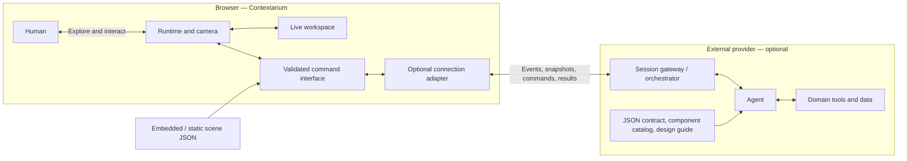

# Contextarium — Agent integration architecture

**Version:** 0.1 (proposed integration design)  
**Date:** 2026-11-26  
**Status:** Conceptual design and implementation plan; no real agent connected yet.

Companion to [Contextarium Architecture](Contextarium-Architecture.md), [Design Guide](DESIGN.md), [Roadmap](ROADMAP.md) and the [runtime contract](../README.md).

## 1. Intent

Contextarium is the visual and interactive surface for an external intelligence. An agent can build a workspace, progressively reveal information, react to a person's exploration and proactively add findings. It drives the page through declarative JSON, not by writing HTML, executing JavaScript, simulating browser clicks or manipulating the DOM.

The browser owns the live workspace. The agent owns its reasoning, domain knowledge, objectives and tool access. A conventional program can occupy the agent's place; Contextarium itself must not depend on an LLM, any specific model vendor, a backend, or an agent framework.

A standalone HTML file with embedded or static JSON remains a valid deployment.

## 2. Logical architecture



The gateway is a logical role, not a required independent service. In a small deployment it could be part of the agent application. It owns network connectivity, session routing and authentication when required. The agent decides what should change; the browser validates the request and determines what was actually applied.

### Responsibility split

| Responsibility | Contextarium runtime | External provider |
| --- | --- | --- |
| Live objects, geometry, hierarchy and behaviors | Authoritative for current session | Reads state and proposes changes |
| Camera, human control and animation execution | Owns local mechanics and veto | May request focus or choreography |
| Content selection, composition and spatial intelligence | Renders supplied layout and enforces objective constraints | Decides what to present, where, and why |
| Domain data and external actions | No inherent domain access | Retrieves data and authorizes tool operations |
| Design language | Trusted components and supported properties | Follows component catalog and stylistic guide |
| Persistence and shared synchronization | Optional, not foundational | May save snapshots if later enabled |

## 3. The agent in the loop

An agent needs four inputs: a user objective, the relevant domain information, the current workspace (or relevant subset), and a versioned description of Contextarium's supported capabilities and design rules. It produces a scene or a bounded command batch, not new executable UI code.

```mermaid
sequenceDiagram
    actor H as Human
    participant F as Contextarium
    participant G as Provider gateway
    participant A as Agent
    participant T as Domain tools
    H->>F: Click or zoom into a service
    F->>G: Declared event + relevant context
    G->>A: Objective, event, scene context, contract
    A->>T: Retrieve relevant details
    T-->>A: Findings
    A-->>G: Proposed JSON mutation batch
    G-->>F: Commands
    F->>F: Validate and apply; enforce camera veto
    F-->>G: Applied / rejected + revision
    G-->>A: Outcome
    F-->>H: Updated workspace
    Note over H,F: Navigation remains local throughout
    T-->>A: New information (if monitored)
    A-->>G: Proactive update
    G-->>F: Push commands if connected
    F-->>G: Outcome
```

This loop allows both reactive and proactive behavior. The agent can continue investigating while the user explores. Neither every pointer movement nor every animation frame requires an LLM call. Send declared semantic events, debounce repeated triggers, and preserve the browser's local responsiveness.

### Example: vulnerability investigation

1. The initial workspace shows services, risk counts and a high-level investigation summary.
2. The user selects a critical findings object or crosses a configured zoom threshold.
3. The runtime sends a meaningful event such as `widget.action` or `camera.enter`, including the object identity and relevant context.
4. The provider retrieves findings, prioritizes them, and composes a details board using the design guide and current object geometry.
5. The provider returns a validated command batch that updates a metric, creates the board and optionally requests a camera flight.
6. The runtime commits the workspace changes locally. If the human has taken camera control, the focus request is suppressed; the new content remains available.
7. A subsequent finding can be delivered proactively through an optional push connection, without forcing the user away from their current view.

## 4. Integration modes

| Mode | Mechanism | Status / tradeoff |
| --- | --- | --- |
| Standalone | Embedded JSON or imported file | Existing; no agent or network required |
| Static HTTP | Load a scene and GET registered JSON resources | Existing prototype; real HTTP behavior not yet verified end to end |
| Reactive provider | Registered endpoint responds with generated command arrays | Minimal next milestone; current same-origin GET pathway can support a deterministic endpoint |
| Bidirectional agent session | Browser adapter sends events and snapshots, receives commands and acknowledges outcomes | Proposed; enables agent awareness and proactive delivery |
| Durable/shared workspace | Optional persistence and synchronization | Deferred; unnecessary for an initial agent session |

### 4.1 Start with the existing HTTP path

The current [scene-http.json](../scene-http.json) registers a named source and declares a button-triggered behavior:

```json
{
  "id": "details-click",
  "on": {"event": "widget.action", "target": "risk", "name": "details"},
  "actions": [{"command": "data.fetch", "source": "risk-click"}]
}
```

The source is currently defined as `{"kind":"http","url":"./risk-click.json"}`. A same-origin server could instead serve a deterministic response at that path or a registered API path. A response can use the current command vocabulary:

```json
[
  {"command":"object.update","target":"risk","props":{"value":9}},
  {
    "command":"object.upsert",
    "object":{
      "id":"details","type":"board",
      "x":1900,"y":-550,"w":1600,"h":900,
      "props":{"label":"DISCOVERED","title":"Affected services",
               "text":"Example findings supplied by a provider."}
    }
  },
  {"command":"camera.focus","target":"details"}
]
```

This example assumes the sample scene is loaded and its `risk` object exists. It is an illustrative response using existing command shapes, not an independently executed test. The current HTTP source mechanism fetches a configured URL; it does not send arbitrary event payloads or live snapshots to the server. A static endpoint can be swapped for a dynamic provider without changing the rendering model, but the provider has only the context it is actually sent.

### 4.2 Add a thin optional connection adapter

For a complete agent loop, the adapter should bridge the runtime's local interface to a remote session. The current in-browser JavaScript API exposes `contextarium.getState()`, `contextarium.loadScene(scene)`, `contextarium.dispatch(command)`, `contextarium.batch(commands)` and `contextarium.events`. These are not remotely accessible APIs.

A first adapter could use HTTP POST for events and snapshots, and server-sent events (SSE) for unsolicited commands. Alternatively, a WebSocket could carry bidirectional messages over one session. Either is viable; neither is ratified. HTTP plus SSE is a provisional starting recommendation because it separates browser-to-provider requests from server-to-browser delivery. A fetch-only demonstration should precede either.

Proposed transport-neutral message categories:

| Direction | Message | Purpose |
| --- | --- | --- |
| Browser → provider | hello/capabilities | Contract version and supported features |
| Browser → provider | event | Declared interaction or runtime occurrence |
| Browser → provider | snapshot | Relevant live scene, geometry and revision |
| Provider → browser | query | Request relevant state or capabilities |
| Provider → browser | scene / commands | Initial definition or incremental changes |
| Browser → provider | result | Correlated acceptance, rejection, or camera veto |

Illustrative **future** envelope (not accepted by the current command API):

```json
{
  "kind":"commands",
  "sessionId":"demo-session",
  "messageId":"m-0042",
  "schemaVersion":1,
  "baseRevision":12,
  "commands":[
    {"command":"object.update","target":"risk","props":{"value":9}}
  ]
}
```

The adapter unwraps a valid envelope, verifies its session and revision, invokes the runtime's validated mutation interface, and returns a result such as the message ID, outcome, resulting revision and any camera veto. Revision tracking, envelopes, acknowledgements, remote queries and connection lifecycle are proposed additions, not current features.

## 5. How the agent knows what to generate

Provide an agent with a versioned authoring package:

- JSON schema, command vocabulary, validation errors and event definitions.
- Component catalog: trusted types, supported properties, geometry, nesting and interaction options.
- Design guide: visual hierarchy, spacing, typography, semantic zoom, motion and accessibility rules.
- Examples of complete scenes and incremental command arrays.
- Current workspace snapshot or selected object geometry when composing updates.

The agent can use structured model output and deterministic validation at the provider before sending JSON. Browser validation is still required. If a command is rejected, return the reason and let the provider repair it within bounded retries. Do not let the agent invent unsupported components or bypass the design system by emitting HTML or CSS. The runtime must not become an intelligent automatic layout engine.

An agent should prefer incremental updates and preserve stable IDs and existing spatial landmarks. A full scene replacement is appropriate for initialization or intentional reset, not routine refreshes. Visual quality requires rendered-composition review in addition to schema correctness.

## 6. Deployment and trust boundaries

**Standalone/static:** GitHub Pages or another static host can serve the HTML and illustrative JSON fixtures, but cannot itself run an agent gateway or arbitrary server-side application logic. No API credentials belong in the HTML, repository or scene JSON.

**Connected deployment:** Serve the runtime and provider endpoints through a common HTTPS origin (for example, a reverse proxy routing the static page and API). This is compatible with the prototype's existing same-origin fetch and `connect-src 'self'` CSP. Hosting the browser on GitHub Pages while the provider lives on another origin would require deliberate changes to CSP, origin validation, CORS for cross-origin HTTP and the chosen authentication design. A static website alone does not grant the agent access to the browser.

**Controls for future connected use:**

- Treat all incoming data and generated commands as untrusted. Validate types, properties, size, geometry and permitted action vocabulary; no arbitrary HTML, JavaScript or arbitrary network destinations.
- Authenticate the human and provider/session where required, authorize mutation scopes, and protect domain tool actions separately. Display permissions are not permission to operate external systems.
- Minimize event/snapshot data; do not send secrets or unnecessary sensitive domain content to the agent. Treat fetched content as data, not authority to change instructions or invoke privileged tools.
- Correlate operations, reject stale revisions, deduplicate message IDs, cancel outdated work, enforce quotas and bound event feedback loops. Suppress automatic camera actions when human control takes precedence.
- Record useful operation outcomes; support reconnect by requesting the current browser snapshot rather than assuming the agent's cached state is authoritative. No durable synchronization is required.
- Verify derivative licensing before public redistribution; use synthetic data for the initial demonstration.

These are proposed safeguards, not production security claims about the current prototype.

## 7. Recommended implementation sequence

1. **Deterministic provider:** Serve the existing runtime and scene from one local HTTP origin; implement a simple route returning sample command arrays. Verify click and zoom requests with browser automation, invalid-response rejection and camera takeover.
2. **Reactive adapter:** Forward selected runtime events and relevant snapshots to the provider, correlate requests and report results; keep static mode unaffected.
3. **Proactive adapter:** Add one push transport, session lifecycle, duplicate/stale response handling, reconnect and human camera precedence. Use a timer or deterministic test signal to simulate an unsolicited finding.
4. **Agent integration:** Replace the deterministic composition logic with an agent constrained by the authoring package, with bounded validation/repair and explicitly scoped tools. Demonstrate both reactive and proactive updates.
5. **Choreography and robustness:** Add generalized interruptible sequences and verify visual consistency, accessibility, resource limits and authorization before production use.

### Acceptance criteria for the first agent milestone

- The exact same HTML runtime can run offline with embedded JSON and connected to a provider.
- A user interaction leads to a provider-generated valid mutation; it appears without a page reload or manually editing HTML.
- A provider can discover existing object positions and update them by stable ID.
- An unsolicited update arrives while the user explores a different area.
- A malformed or stale batch is rejected without corrupting live state.
- The provider receives observable operation results; the human can override any requested camera flight.
- No model credentials or external tool privileges are embedded in the browser; the connection can be disabled.

## 8. Decisions deliberately left open

The precise transport, session authentication, envelope/schema, event forwarding policy, revision semantics, push reconnect behavior, choreography vocabulary, agent framework/model, and persistent storage remain design decisions. No production agent, remote event adapter, server push, or generalized choreography is claimed to exist today. The current README reports browser tests of embedded behaviors, but real HTTP/file navigation was blocked in the prior test environment.

**Architectural principle:** The agent supplies the intelligence; Contextarium supplies the spatial mechanics and human-controlled experience. The integration must extend, not replace, the standalone declarative runtime.
