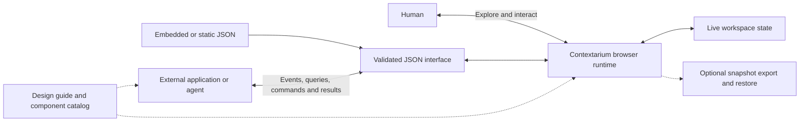

# Contextarium — Architecture Specification

**Version:** 0.1 (architecture baseline)  
**Date:** 2026-11-26  
**Status:** Agreed architectural direction; implementation details and prototype verification remain open.

## 1. Purpose and vision

Contextarium is a browser-native, interactive spatial workspace for exploring and working with information. It is not a slide deck, a general-purpose visual editor, or an AI application in its own right. Its purpose is to make dynamically generated information intuitive, coherent and visually engaging through a continuous two-dimensional world, semantic zoom and smooth visual choreography.

The simplest deployment consists of a standalone HTML file with embedded JSON or an optional separate JSON document. The same runtime can be connected to an external application or agent that progressively constructs and modifies the workspace. No dedicated backend, AI service, framework or third-party runtime dependency is mandatory.

Contextarium is an independent derivative of Spatial Explainer. The original Spatial Explainer must remain unchanged. Its camera, continuous spatial world, drafting-board aesthetic and animation techniques are the starting point; earlier Fieldwork experiments are requirements references, not the implementation foundation.

## 2. Agreed architecture decisions

| ID | Decision | Consequence |
| --- | --- | --- |
| AD-01 | Browser owns the authoritative live workspace for its session. | External systems provide data and commands, not a mandatory synchronized state store. |
| AD-02 | JSON is the declarative boundary between the runtime and content providers. | Embedded, static, dynamically generated, pulled and pushed data use the same logical contract. |
| AD-03 | Humans interact with the workspace but do not restructure it by default. | Providers declare affordances; direct manipulation is available only where explicitly enabled. No general visual authoring UI is required. |
| AD-04 | External systems may initiate proactive changes. | Contextarium can evolve without a preceding human interaction; push is optional in connected deployments. |
| AD-05 | External systems may orchestrate visual choreography. | Camera navigation, reveals and animation sequences are declarative and locally executed; human navigation retains precedence. |
| AD-06 | Spatial intelligence belongs to the content provider. | Contextarium implements spatial mechanics and follows supplied layout instructions rather than inventing arrangements. |
| AD-07 | Design system, component catalog and runtime contract are distinct artifacts. | Content providers can compose within a defined visual vocabulary, with objective constraints enforced by the runtime. |
| AD-08 | Synchronization is optional, not foundational. | Stable object identifiers, serializable workspace state and versioned changes preserve the possibility of later persistence and synchronization. |

## 3. Logical architecture

The content provider determines what information is useful, how it should be composed, where it belongs and which interactions are meaningful. The runtime is domain-independent and does not require the provider to be an AI agent. An ordinary program or a human-authored JSON document can be a provider.

The design system is a separate logical concern, even when its implementation is embedded in the HTML distribution. Runtime constraints and provider guidance should share versioned definitions so the provider knows what it can use.

### Runtime responsibilities

- Maintain and render the live workspace; manage the camera and local interaction state.
- Provide a continuous world with arbitrary object coordinates, sizes, nesting and optional drafting boards.
- Support geometric zoom (changes in scale) and semantic zoom (changes in information or available detail).
- Apply validated object, content, layout, behaviour and navigation changes.
- Dispatch declared events, perform permitted requests and process responses asynchronously.
- Execute visual transitions and sequences locally, without depending on continuous network round trips.
- Expose workspace information and operation results to configured providers.

### Content provider responsibilities

- Select and interpret domain information; generate valid declarative content and mutations.
- Define intuitive spatial composition, grouping, hierarchy, relationships and progressive disclosure.
- Follow the selected stylistic guide and use supported components, behaviours and animation primitives.
- Inspect existing workspace geometry where needed; preserve spatial continuity when adding or changing objects.
- Handle domain operations, data access and any persistent external application state.

Contextarium may calculate geometry, fit the camera to bounds, resolve anchors and eventually offer deterministic grid/stack helpers. It is not responsible for deciding the semantic importance or ideal placement of information. Automatic intelligent layout is deferred.

## 4. Workspace and state model

The workspace state must be representable as data rather than executable application logic. It describes spatial objects, optional parent/child relationships, visual properties, content, declared behaviours and relationships. Objects have stable identities, types and geometry. Objects may exist directly in the world or inside containers; boards are optional, not the universal layout unit.

Separate the following state categories:

| State | Authority |
| --- | --- |
| Workspace structure, content and declared behaviours | Browser's live workspace; changed through validated commands |
| Camera, selection, input and active choreography | Browser; external camera requests are subject to human precedence |
| Domain data, investigation progress, agent objectives | External provider, when present |
| Durable copies and cross-device state | Optional future persistence/synchronization mechanism |

A snapshot should be sufficient to reconstruct the declarative workspace. Camera and transient interaction state may be captured separately. Proposed safeguards for implementation include schema versions, workspace revision numbers, unique command identifiers and consistent acknowledgements. Exact revision and conflict rules have not yet been approved. Without persistence, refresh or closure may discard live changes; no shared-state or collaboration guarantee is implied.

## 5. Declarative interface

The interface should distinguish full workspace definitions, incremental changes, queries, events and results. Delivery mechanism must be independent of the meaning of a message.

| Message category | Purpose |
| --- | --- |
| Workspace definition | Initialize or restore a workspace from JSON |
| Mutation | Create, update, move, resize or delete objects; register/remove behaviours; update navigation and choreography |
| Query | Inspect objects, hierarchy, positions, bounds, supported capabilities or a snapshot |
| Event | Notify a configured provider about a declared interaction or runtime occurrence |
| Result | Report success, rejection or failure, with enough context for the provider to recover |

The previously reported prototype uses commands including `object.upsert`, `object.update`, `object.delete`, `object.move`, `object.resize`, `behaviour.upsert`, `behaviour.delete`, `camera.focus`, `camera.set` and `camera.overview`. These names are an implementation reference, not a ratified wire specification. The complete schema, query API, choreography vocabulary, batch semantics and error model still require definition and testing.

Data may arrive through embedded JSON, a static resource, an HTTP response, or optional connected delivery such as server-sent events or WebSocket. No specific push protocol or backend stack has been chosen. A normal static HTTP host can serve the standalone HTML and JSON without an application backend; opening an HTML file directly may restrict cross-file fetches under browser origin rules.

## 6. Interaction and choreography

The human can freely navigate the world and use the interaction affordances defined for its components. Examples include selecting, filtering, expanding, entering information, activating controls and triggering requests. Arbitrary dragging, resizing or deleting of spatial objects is not available by default. An explicitly enabled object may permit such actions as part of its declared behaviour. Human-enabled structural changes and external changes should share the validated mutation path.

Example event-driven flow:

1. A user zooms into a service within a system diagram.
2. Contextarium detects a declared semantic zoom threshold and requests details.
3. The provider returns JSON describing a new details panel and its layout.
4. Contextarium validates and applies the change, revealing the panel smoothly without unnecessarily moving the user's camera.
5. The provider may subsequently send unsolicited updates as additional findings become available.

Choreography includes camera movements, sequential or concurrent reveals, emphasis, object transitions and ambient animation. It must be usable without narration or an audio-driven master timeline. The external provider specifies the desired sequence through data; the runtime handles timing, interpolation and interruption locally. Human navigation must override externally controlled camera movement. Whether interrupted sequences can resume, how unsolicited camera requests are presented, and how concurrent sequences arbitrate are detailed design decisions still open.

## 7. Design system and provider enablement

The provider-facing contract requires three complementary deliverables:

- **JSON schema and interface documentation:** supported structures, properties, commands, events, versioning and errors.
- **Component catalog:** trusted component types, dimensions/constraints, accepted content, interaction options and illustrative examples.
- **Stylistic guide:** visual hierarchy, typography, semantic colours and non-colour cues, spacing, grouping, density, animation conventions, semantic zoom and composition patterns.

The initial design direction derives from Spatial Explainer's drafting-board aesthetic, continuous canvas and restrained visual motion. The guide should support the user's intended visual identity without requiring every workspace to use fixed boards or a predetermined spatial layout. The runtime should enforce objective limits and supported variants; providers remain responsible for subjective quality. A valid JSON payload does not guarantee a coherent or useful presentation.

Proposed implementation practice: provide example compositions and an external generator validation workflow, including rendered-output review. Specific tokens, theme customization, initial component set and accessibility acceptance thresholds remain to be ratified.

## 8. Trust boundary and constraints

Incoming JSON is data, not arbitrary JavaScript, HTML or executable instructions. The runtime must validate changes against supported component and action types and reject unsupported or unsafe requests. External responses may influence all five areas — content, objects, layout, behaviours and navigation — only through the declarative contract.

Recommended safeguards for the connected prototype include safe text rendering, restricted request destinations and methods, resource limits, cancellation, duplicate/stale response handling, event throttling, prevention of unbounded event/action loops and explicit errors. These are proposed implementation controls, not claims of existing protection. Any effect on real external systems must be independently authorized by those systems. Authentication and production authorization design are deferred; a prototype should use controlled endpoints and non-sensitive test data.

## 9. Prototype status and remaining work

The uploaded reference source is the original Spatial Explainer, not the rebuilt Contextarium derivative. Inspection of that source confirms its fixed 1600 × 900 sheets, ring layout, cue/clock-driven reveals and camera/overview mechanics. The earlier conversation reported an independent Contextarium derivative and tests, but its actual source files are not available in the current working directory. Consequently, the following status is based on reported prior work, not a fresh audit of Contextarium.

| Capability | Status / next action |
| --- | --- |
| Spatial Explainer visual and camera foundation | Reference source confirmed; derivative inheritance reported |
| Arbitrary geometry, nested boards and independent objects | Reported implemented; reverify against latest source |
| Geometric and semantic zoom | Reported implemented; reverify |
| Validated commands and event/action processing | Reported implemented and tested with embedded demo; schema hardening remains |
| Event-triggered HTTP requests | Reported implemented; real HTTP end-to-end integration not verified |
| Human camera precedence | Reported tested; test interrupted and conflicting choreography |
| Human interaction only by declared affordances | Architectural decision; audit default editing capabilities |
| Unsolicited server push | Required capability; no push transport reported implemented |
| General declarative visual choreography | Partial foundation; general SVG/sequence orchestration not established |
| Provider layout/geometry inspection | Required; complete query contract and coverage unverified |
| Snapshot export/restore and versioned changes | Required architectural direction; implementation not established |
| Design guide, component catalog, versioned JSON schema | Required deliverables; formal versions not established |
| Real AI agent integration | Deferred; not connected or validated |

## 10. Recommended implementation sequence

1. **Reconcile the baseline.** Recover the independent Contextarium source, verify lineage, run the existing demo, and check source licensing before redistribution. Do not modify Spatial Explainer.
2. **Freeze a minimal contract.** Document supported objects, mutations, events, queries, versioning, batch validation, errors and snapshot semantics. Publish initial component catalog and design guide with reference examples. Enforce interaction-only defaults.
3. **Validate connected operation.** Use a minimal deterministic test provider (not an AI agent) to retrieve details on interaction, respond with validated JSON, send an unsolicited update, and observe outcomes. Select a provisional push adapter only for the test. Keep standalone operation intact.
4. **Generalize choreography.** Add local, interruptible declarative sequences beyond simple camera commands and reveals; check human precedence and reduced-motion behaviour.
5. **Test provider composition.** Generate a second workspace from the same contract without changing HTML. Test explicit external layout, geometry queries and consistent design, including incremental additions and invalid data.

The recommended next milestone is a standalone-capable runtime with a repeatable, end-to-end connected demonstration. It should pass the following acceptance tests:

- Embedded JSON initializes a usable workspace without an application backend; static JSON loads in a supported browser hosting mode.
- The same HTML renders two meaningfully different workspaces without runtime changes.
- A declared interaction fetches content; the response can create objects, behaviours and layout changes.
- A provider pushes an unsolicited update while the user explores elsewhere; the user's camera is not unexpectedly taken over.
- A provider starts a local visual sequence; human navigation interrupts camera control.
- Invalid data and unsupported actions are rejected without corrupting existing workspace state.
- A snapshot round-trip reconstructs the same declarative objects and layout; stable IDs survive.
- Generated compositions conform to the catalog and design guide; overlapping or unreadable content is reported or corrected by the provider rather than silently rearranged by Contextarium.

## 11. Explicitly deferred scope

Production authentication/authorization, durable storage infrastructure, automatic synchronization, multi-user collaboration, cross-device continuity, MCP integration, specific AI models, backend framework selection, advanced automatic layout and a general-purpose authoring interface. Narration is not required. These deferrals must not become mandatory runtime dependencies.

## 12. Provenance and remaining decisions

This baseline consolidates the architecture discussion of November 26, 2026 and earlier Contextarium decisions. Source reference: the supplied `Pasted markdown(9).md` (Spatial Explainer HTML), notably its board/world layout (lines 39–76, 468–470, 843–930), reveal vocabulary (118–149), timeline (349–438), camera interpolation (1003 onward) and background renderer (1311 onward). The existing derivative was not available for a fresh code audit, and its licensing and integration status remain unverified.

The numbered implementation sequence, suggested message categories, security safeguards and acceptance criteria are proposed engineering choices, not additional user-approved architectural decisions. Exact wire schema, initial component inventory, theme mechanics, push transport, choreography interruption policy and revision/conflict semantics require technical design. No code or existing project files were modified by this specification.
