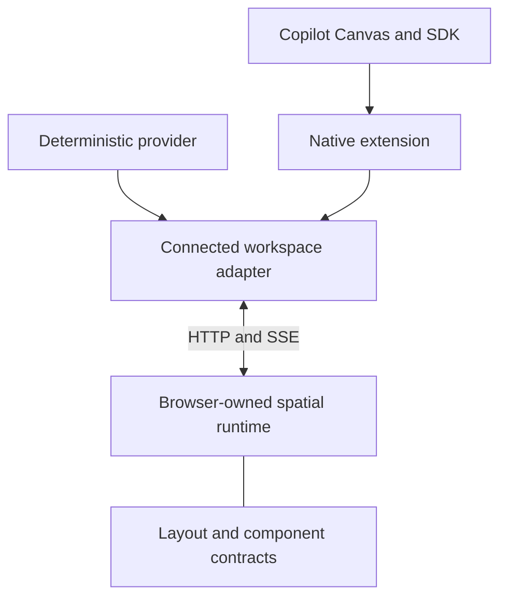

# Contextarium architecture

Contextarium is a GitHub Copilot Canvas plugin with a platform-independent spatial renderer. The same browser runtime opens as a standalone file, runs with a deterministic provider, and renders in Copilot’s Canvas panel.

## Implementation boundaries

| Boundary | Responsibility |
|---|---|
| Portable runtime | The root `index.html` owns live workspace state, the scene validator, rendering, camera and local interactions. It contains the embedded demo and opens without a server. The adjacent JSON files are examples for the import and HTTP paths. Smoke tests check their parity with the embedded scene. |
| Portable core modules | `core/contracts.mjs` defines host-facing input schemas. `core/layout-contract.mjs` defines sizing and fitting. `core/layout-browser.mjs` measures rendered geometry and readability. Browser runtime checks govern accepted scene contents and operations. |
| Connected workspace adapter | `connect/` serves the canonical page with the shared fitting rules and a browser bridge. It carries requests over SSE and returns acknowledgements and events over HTTP. Host adapters configure the request label and event. It has no model or SDK dependency. |
| Copilot | The native entry point registers Canvas actions and handles instance lifecycle and enqueueing. Copilot's installed-plugin cache contains the same package assets. The marketplace, plugin, extension and Canvas identifiers remain stable. |

The deterministic provider exercises the same transport and command path as Copilot. The connected workspace uses an allowlisted file set and an ephemeral loopback server. Its preview uses the same renderer and fitting rules to measure candidate scenes at sampled viewport, zoom, and focus settings. Preview omits behaviours and sources and leaves the live workspace untouched.

## Authority and data

- The browser owns the authoritative scene and camera. Providers compose through declarative, validated JSON commands. Stable object IDs identify reusable workspace objects.
- A validated batch commits scene mutations atomically. A camera request has its own outcome and respects human control. Human navigation can suppress provider-requested camera movement while allowing content updates.
- The connected host correlates operations and checks a scene revision and renderer epoch before applying mutations. A scene replacement resets its revision and advances the epoch. Reinspect after a timeout or reconnect because a lost acknowledgement leaves the outcome uncertain.
- The provider owns domain data and spatial composition. The runtime can fit text and measure overlap. It does not choose semantic arrangement or optimize layout on the provider's behalf.
- Explicit interaction can request agent work. The manual-zoom prompt heuristic is opt-in; passive telemetry alone does not enqueue a prompt.

See the [scene and browser contract](SCENE-CONTRACT.md), [connected host guide](AGENT-INTEGRATION.md), and [authoring guide](AUTHORING.md).

## Limits

The loopback session uses a scoped URL, origin checks, bounded input, and rate-limited provider requests. It is designed for a local session and synthetic development data. Durable persistence, cross-device sync, public hosting, and production access control are outside the current product. Layout checks sample geometry and font sizes. They cannot establish contrast or full accessibility. General choreography beyond the current camera and declarative reveal behaviours remains deferred.

## Provenance

The supplied *How This Explainer Works – Spatial Presentation PoC* HTML is the Spatial Explainer reference. Contextarium retains its camera interpolation, scale arc, background rendering and parallax dust, palette, sheet marks and board styling. It adapts coordinate conversion and camera fitting, and uses declarative content in place of the fixed presentation sequence, audio, timeline and cues. Earlier Fieldwork experiments are requirements references. Verify the derivative’s licensing before redistribution.
