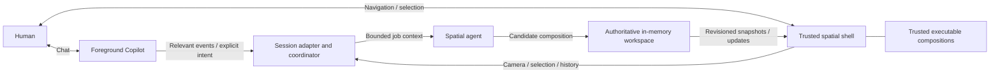

# Contextarium redesign — feasibility research

**Status:** Revised feasibility and implementation guidance (2026-11-27), following live validation and explicit user acceptance of trusted executable content and inherited Copilot permissions.  
**Companion:** [REDESIGN.md](REDESIGN.md) is authoritative.  
**Historical evidence:** [Original feasibility research at 79331b0](https://github.com/ericslandry/contextarium/blob/79331b0c949308e74255309ece9548a6f5cc4d38/docs/REDESIGN-FEASIBILITY.md); [validation report at fd1e2de](https://github.com/ericslandry/contextarium/blob/fd1e2de83abd9dbe5a6fd8a1cc84beeca1e0c69e/docs/REDESIGN-VALIDATION.md); [detailed measurements at 7d5435a](https://github.com/ericslandry/contextarium/blob/7d5435a4d5d5c78cf4bc2a7bd234f184fcb869c0/docs/REDESIGN-VALIDATION.md). The current revision introduces no new experimental observations.

## 1. Executive recommendation

Proceed with the clean redesign and a bounded integrated prototype. Native Dynamic Workflows demonstrated live foreground/background model overlap and, separately, deterministic publication to a native Canvas. Adopt this preview mechanism provisionally behind a small adapter. The separate SDK runtime was unauthenticated in the tested setup; set it aside unless needed.

**Render trusted HTML/CSS/SVG/JavaScript in one shared browser document.** Mandatory sandboxed iframes, prohibition of generated JavaScript, and composition-only worker permission enforcement have been explicitly superseded by the user's revised trust model. Follow the original Spatial Explainer's direct browser-native approach where it fits. Preserve independent composition identity, spatial navigation and coherent publication without requiring each composition to be a separate browser document.

The prior opaque-frame tests proved rich content could render but did not establish smooth navigation (native p95 frame interval 100 ms with five compositions during a scripted 100× zoom stress test). They did not isolate the performance bottleneck. Direct rendering is now the primary approach to test; optimize for actual experience, not for preserving the iframe design. Accidental styling defects and rendering overload are quality concerns, not security acceptance gates.

Use a session-scoped in-memory state manager and one logical composition writer. Separate scene revisions, conversation context freshness and human navigation epochs. Keep native Copilot permissions; no extra composition-only security policy. Do not add privileged bridge operations that circumvent existing Copilot enforcement. Browser-executed JavaScript does not automatically inherit Copilot's tool permission checks; the actual native WebView capability boundary remains to be verified.

The remaining priorities are event attribution, one integrated model-to-Canvas path, direct executable composition rendering and interaction, and native lifecycle/authoring guidance.

## 2. Copilot integration: evidence and gaps

### 2.1 Evidence matrix

| Capability | Evidence | Remaining uncertainty |
|---|---|---|
| Join an existing session from an extension | Documented and implemented in SDK source [G1–G3]; existing plugin uses it | Exact installed version and session lifetime |
| Observe foreground events | Extension examples show session event subscriptions [G2]; event reference documents message/turn/idle events [G4] | Delivery in desktop Canvas host; ordering, replay, attachment scope and event visibility |
| Start independent SDK sessions | Public SDK client supports session creation, per-session model, tools and event handlers [G5] | Whether desktop-installed extension can start/authenticate a second runtime without additional setup |
| Native background orchestration | Dynamic Workflows run concurrently with interactive work and can be triggered through extensions [G6]; current extension source exposes workflow registration [G3] | Preview API support, permissions, cost, cancellation, session lifecycle and UI impact |
| Delegate to a custom agent | Custom agent and Fleet documentation [G7, G8] | Parent-turn dependency, actual independent progress, inherited tools and permissions |
| Inherit existing Copilot permissions | Dynamic Workflows inherit session grants [G6]; SDK also documents explicit tools and empty mode [G9] | Verify that Contextarium adds no bypass of host enforcement; no need to prove a composition-only tool catalog |
| Observe usage | Usage events, session metrics and account quota APIs [G10] | Availability and actual charges in target account; background work is not assumed free |
| Bundle a skill | Plugin format supports skills; SDK has explicit skill configuration [G11, G12] | Discovery under current legacy manifest; background worker skill loading and permission boundaries |
| Native Canvas open/close/actions | Existing Contextarium integration and public Canvas SDK [G13] | Exact wire protocol/version; newer source signatures differ from current plugin |
| Transient state | Application can own an in-memory workspace; SDK lifecycle APIs exist [G5, G14] | SDK may store transcripts or artifacts on disk even when Contextarium is transient |

The matrix records the original upstream findings. The linked validation report records later live and deterministic evidence, including native workflow concurrency, native Canvas publication and the separate runtime authentication failure. No new installed-host experiments were run for this revision.

### 2.2 What the current extension actually does

The shipping entry point [extension.mjs](../plugins/contextarium/extensions/contextarium/extension.mjs) joins the foreground session and calls `session.send({mode: "enqueue", prompt: ...})` on an explicit canvas request. This creates work in that same session. It does not establish an independent spatial agent.

The upstream [extension implementation](https://raw.githubusercontent.com/github/copilot-sdk/main/nodejs/src/extension.ts) resolves the existing session ID from its environment and connects to the parent process. It returns a joined session, not a separately managed client factory. Its current type also includes experimental workflow registration and strips certain options reserved for the session owner. Do not use internal connection fields, extract tokens, access private RPCs or assume that an extension has owner-level privileges. The upstream repository and package naming are evolving; the inspected source redirects between GitHub and Microsoft namespaces. Use installed declarations and compatible released APIs, not a blind copy of main.

The official extension examples include observation of user and assistant messages, tool events and session idle. Start by subscribing to event metadata; capture completed user/assistant messages and useful boundaries, not hidden reasoning, token-by-token deltas or arbitrary tool results. `assistant.message` can occur within a tool-using turn; use turn/session boundaries to distinguish provisional content from useful completed responses. Filter by owning session, deduplicate events and never reflect the spatial agent's own traffic into its input.

### 2.3 Candidate background mechanisms, in recommended test order

| Candidate | Why consider | Why not assume it works |
|---|---|---|
| A. Native Dynamic Workflow | Documented background execution, extension registration and programmatic initiation; potentially reuses host auth and run controls | Preview; may require a newer client, inherits foreground grants, may expose workflow UI/results, could be expensive for frequent small jobs |
| B. Independent SDK session | Explicit lifecycle, scoped tools, model, context and scheduling; strong separation from conversation | Extra runtime/dependency/auth requirements; potential policy mismatch and disk persistence; desktop sign-in alone is not proof of CLI auth |
| C. Foreground custom subagent | Native delegation and isolated reasoning context | Usually initiated by parent task; may delay parent completion or need explicit delegation; insufficient evidence of continuous independent observation |
| D. Existing foreground queue | Proven current fallback, minimal dependencies | Adds turns to foreground session; does not meet nonblocking design objective |

**A: provisional primary mechanism, supported by live evidence.** GitHub's [Dynamic Workflows concept](https://docs.github.com/en/copilot/concepts/agent-capabilities/agent-powered-workflows-and-operations/dynamic-workflows) says background runs can coexist with ongoing session work and can originate in extension tools/hooks or Canvas controls. The source registers workflow handles through the extension join options. A composition run could accept a bounded conversation/scene snapshot, perform one spatial-agent job, and return a structured candidate for the extension to validate and publish. This avoids exposing a background worker to the Canvas transport directly. Confirm the actual supported programmatic start, status, cancellation, structured result and tool scope on installed SDK; do not invent a method signature. Workflow-owned agents inherit existing session permission grants according to GitHub's documentation. The user accepts these inherited grants. Composition is a responsibility, not a separate security principal. Do not impose or test a composition-only permission regime as an adoption gate; use supported permission enforcement and avoid new privileged paths. Also assess whether starting a workflow for a small scene change is excessive and whether visible workflow reports disrupt the desired unified UX.

**B: fallback only if the native path proves unsuitable.** Public SDK APIs support independent sessions, distinct model configuration, event subscriptions, abort and custom tools. GitHub documents stored CLI OAuth credentials and a separate local/bundled runtime path; it does not prove that desktop extension processes can reuse the app's login without configuration. Probe using supported SDK entry points and the signed-in user only. No credential copying or broad token requests. If this fallback becomes necessary, preserve the user's authorized account and normal Copilot permission enforcement; do not duplicate or expand those privileges. Avoid recursive plugin loading. Explicitly supply the composition skill. Confirm the actual available tool list, memory behavior, model availability, storage and shutdown. Avoid granting all tool requests as sample code often does.

**C: useful baseline, not the preferred autonomous architecture.** A custom agent can be valuable for explicit delegation, but the parent may wait for completion. Fleet is intended for decomposable parallel work and is not an obvious match for a continuous shared workspace. Do not convert a simple spatial update into an elaborate multiagent orchestration solely to use Fleet.

**D: retain only as a disclosed fallback.** Existing enqueue behavior is a useful compatibility path, not evidence of asynchronous independent reasoning. A deterministic background provider can validate the rest of the architecture even when live-model integration is blocked.

### 2.4 Authentication, scope, privacy and cost

- Background processing must respect the foreground session's account and organizational policy. Do not assume a second CLI login, API key, BYOK service or separately billed account is acceptable.
- Forward only relevant conversation text and minimal contextual state. Do not automatically transfer attachments, file contents, secrets, entire tool transcripts or hidden reasoning. Explicitly assess data classification and content exclusion.
- Copilot-generated visual content, including executable JavaScript, is trusted under the agreed local single-user model. Existing agent prompt-injection risks are not a reason for a separate composition-only permission regime. Keep normal Copilot permission checks; validate candidate structure, session and freshness for correct publication, not as a malicious-code containment boundary.
- Do not start background reasoning merely because the plugin is installed. Activation should be apparent to the human; support pausing background composition. This is a proposed safeguard for the continuous-update UX, not an agreed new product feature.
- Keep one active spatial job per owning session initially; coalesce relevant events, limit update frequency, context/output size and job duration. Do not invoke on every message delta, selection or zoom event. Explicit user intent is prioritized.
- Use `assistant.usage` or supported aggregate usage metrics and account quota observations where available [G10]; record the actual billing units exposed by the host. There is no evidence that an independent job is free or shares a single foreground request charge. Limit tests and use synthetic data.
- A transient Contextarium workspace does not imply a transient Copilot transcript. Verify SDK-generated session files, logs and workflow artifacts, retention and supported cleanup [G14]. Do not delete the user's foreground session or existing history. Background session cleanup must target only resources created by the plugin.

## 3. Rich visual compositions

### 3.1 Primary rendering approach

Use the browser as the creative substrate: direct HTML, CSS, SVG and JavaScript within a shared document, with stable spatial wrappers and a common world/camera transform. The engine does not need to understand the internal subject matter. Native elements, SVG images, snapshots, Shadow DOM or iframes remain optional implementation choices when useful for a particular composition, not mandatory security boundaries.

| Approach | Role in revised design |
|---|---|
| Direct HTML/CSS/SVG/JS | Default candidate; maximal creative expression and DOM access for layout checks |
| Shadow DOM or scoped CSS | Optional style organization; not a security boundary |
| Sandboxed iframes | Historical comparison or optional functional mechanism; not required |
| SVG image / raster snapshot | Optional overview or performance representation; may sacrifice native interaction or sharpness |

Previously tested iframe configurations and CSP cases are retained in the linked validation reports. No inference that direct DOM rendering is faster has been validated yet.

### 3.2 Trust and host boundaries

The user accepts the same trust for Copilot-authored executable visual content as for Copilot-generated code, and the same trust/permissions for the spatial agent as the conversational agent. Generated JavaScript is an intended capability, not an attack to block. Do not require sanitizer-based script removal, CSP rules designed to disable authored execution, cross-composition containment, or a separate worker tool allowlist. Ordinary platform protections should not be disabled or bypassed.

A shared document gives scripts access to the renderer DOM and its JavaScript environment. Copilot's agent tool permission checks are not a demonstrated constraint on browser-originated requests or WebView bridge calls. Inspect the installed native host and Contextarium's existing endpoints; test a small harmless permitted operation and confirm there is no new path to privileged host actions without the normal authorization mechanism. Do not create direct shell/filesystem/token/private RPC or automatic tool-execution capabilities for composition scripts. If the host exposes such a path, report the actual evidence and solve that specific boundary, rather than reinstate blanket content isolation by default.

Visual interference and rendering load are accepted as security risks and remain quality matters. Do not require exhaustive adversarial CSS/SVG/JS testing or resource confinement. Preserve basic renderer/session identity and routing, teardown and freshness checks as correctness invariants. Trust of third-party executable imports and external resource/data transfers has not been separately decided; use trusted fixtures and document actual browser capabilities. No arbitrary expansion of permissions or weakening of the host's policy follows from the accepted content trust model.

### 3.3 Spatial model and composition lifecycle

A composition has authored local dimensions, stable ID, world placement, scale, visibility, opacity and content revision. The trusted/common spatial engine controls navigation and coordinates. Prefer transforming a shared world instead of reflowing all content during camera motion. A move or fade should not reload the composition. Preserve independently addressable objects, meaningful spatial relationships and progressive coherent updates.

Conceptual math:

~~~text
worldScale(node) = worldScale(parent) × localScale(node)
worldPosition(node) = worldPosition(parent) + worldScale(parent) × localPosition(node)
screenPosition = viewportCenter + cameraScale × (worldPosition - cameraCenter)
~~~

Define a minimal lifecycle for inserting/updating/removing authored markup and executing its script in the supported host. Test actual script execution; assigning innerHTML alone does not execute inserted script elements. Prefer a clear mount/update/dispose convention and normal cleanup of timers, listeners, observers and animations. This is a cooperative authoring contract, not enforcement against hostile trusted code. Provide ordinary event routing so an interactive composition can handle input while the user can still take camera control. Test keyboard use, text selection and native controls. Avoid a new rigid widget API for simulations, custom interactions or diagrams.

### 3.4 Validation and performance

Shared DOM permits direct layout measurement without an opaque-frame inspection workaround. Preserve useful layout checks and sampled viewport validation, but judge creative compositions on their intended visual experience rather than universal card/overlap rules. Validate basic candidate structure and coherent state transitions. Include meaningful zoom levels, clipping, readability, navigation history and responsive visual composition.

Compare identical content and camera paths in standalone Edge and the actual Copilot Canvas WebView: empty shell, direct HTML/SVG, direct HTML/SVG with representative JavaScript interaction, and historical or equivalent iframe control if useful. Measure ordinary navigation separately from extreme zoom stress. Record median and p95 frame intervals, viewport and hardware/host conditions; distinguish frame intervals from average FPS and total memory from shell heap. A smooth 60 FPS experience is a proposed engineering target, not a hard security or release criterion. Do not introduce culling, snapshots, LOD or other complexity until evidence shows it improves the experience. Optimize as needed while preserving creative freedom.

## 4. Proposed architecture and state coordination

These are recommended design boundaries, not finalized schema/API choices.

Maintain three different notions of freshness:

| Domain | Owner | Purpose |
|---|---|---|
| Workspace revision and generation | State manager | Atomic accepted mutations, reset/import fencing, renderer sync |
| Conversation context sequence / job generation | Coordinator | Suppress obsolete model results after conversation advances |
| Human navigation epoch | Browser | Veto stale camera guidance after manual takeover |

A job receives a scoped immutable snapshot of relevant conversation context, current workspace revision and current human presentation context. It may return a candidate or no change. The coordinator checks session identity, current generation, revision and relevance before publication. Rebase only if safe; otherwise discard or recompute. The workspace manager is the single commit authority; the agent is not a direct writer to browser DOM. A stale camera request can be rejected independently of valid content changes.

Use one full snapshot on connect/reconnect and bounded revisioned deltas or snapshot replacements thereafter. Test deterministically before optimizing transport. Reuse loopback HTTP/SSE only if its security and delivery semantics fit the new boundary. Keep the renderer independent of Copilot-specific APIs where practical. Validate browser event shape, session and freshness for correctness; do not treat trusted authored compositions as mutually hostile. Validate exact renderer registration and session ownership. Avoid multiple services, databases, generalized message brokers, complex operational transforms or event-sourcing for the transient single-user product.

Export a versioned self-contained workspace artifact, including content and spatial structure, with no capability tokens, credentials or hidden chat transcripts. Validate import structure and document that imported workspaces can contain executable code. Prototype with trusted imports only; third-party import trust is not yet decided. Decide whether camera/viewpoint is an optional export field; no full navigation-history persistence required. Import invalidates in-flight job generations. SDK persistence is a separate concern.

Navigation history should track meaningful completed viewpoint changes, not every animation frame. Store camera coordinates and optional target identity, handle removed targets gracefully, and preserve Back/Forward semantics when new navigation branches. A direct user-requested movement is always permitted; agent guidance is independently vetoable. Breadcrumbs should follow meaningful composition ancestry where known, not pretend there is a hierarchy when none was authored.

## 5. Bundled skill and installation

The current manifest uses the legacy Copilot-specific extension path. Official plugin docs support a root skills directory in the legacy format [G11]. First test `skills/contextarium/SKILL.md` with name/description frontmatter and optional references/examples, retaining working packaging. The newer Agent Plugins format is not automatically a better fit for executable Canvas extensions; verify compatibility before migrating.

For the background provider, use one canonical authoring instruction source, explicitly supplied to the worker until a supported skill-loading path is verified [G12]. The tested workflow-local skills field was rejected. Do not assume that plugin installation automatically injects the skill into a separate runtime or workflow-owned agent. Skills guide model behavior and do not grant tools or permissions. Test native discovery from a fresh session without a checkout. The installed skill must reflect the eventual new workspace interface, not encode the old seven-widget catalog.

Use examples as creative starting points, including text-heavy and diagram-heavy compositions, and make them visual regression fixtures. Favor a short default guide, inspect/compose/validate/publish workflow and minimal repetitive calls.

## 6. Targeted handoff: Work validation protocol

This section supersedes the original gate criteria while retaining gate identifiers for traceability. Do not rerun passed historical experiments without a reason. The linked report is evidence of what actually happened, not the current architecture mandate. Proceed with the bounded integrated prototype on a separate development branch; preserve the shipping plugin. No additional Copilot model prompts without explicit user approval.

### Gate 0 — environment and lifecycle

Use the recorded desktop 1.5.0, CLI 1.0.115-7, protocol 4 results as a baseline; record differences in the actual environment. Use supported installed APIs. Revisit native install/update/uninstall as needed for the redesigned package; local marketplace per-plugin lifecycle was partially unsuccessful.

### Gate 1 — foreground observation (F1)

Resolve foreground/worker event attribution, deduplication, session routing and startup/replay behavior before enabling automatic curation. First use explicit triggers and deterministic events. A live experiment requires approval. Pass: no recursive worker triggering, relevant correctly attributed completed context and reliable teardown.

### Gate 2 — background runtime (F2)

Native Dynamic Workflows have demonstrated concurrent model reasoning. Use them provisionally; inherited foreground grants are accepted. No composition-only permissions test is required. Do not attempt to bypass native permission enforcement. Retain observed usage, cancellation, account and lifecycle questions where relevant. Do not revisit separate SDK authentication unless workflows prove unsuitable. Pass: independent useful background progress without unwanted foreground turns and no new privilege bypass.

### Gate 3 — integrated publication (F3, F5)

Build on the passed deterministic state and model-free native Canvas tests. Demonstrate one foreground-triggered model candidate through structural validation and revision-fenced publication to a visible Canvas (approval required for the live call). Check stale work, reset/import, reconnect, independent camera epoch and human navigation precedence. A background agent proposes content; the state manager commits; renderer mounts it and reports presentation state. Pass: coherent current content appears without blocking foreground work or reverting human camera control. Explicit triggers initially; autonomous coalesced updates once event attribution is reliable.

### Gate 4 — shared-document executable rendering and spatial experience (F4, F7)

Prototype direct HTML/CSS/SVG/JS in a single document; do not require iframes. Use two genuinely different scenes (diagram/illustration and text-heavy) and at least one interactive simulation or custom control authored in ordinary JavaScript. Confirm native host execution, updates, removal, cooperative cleanup, interaction/camera coexistence, zoom, text selection and viewport responsiveness. Verify ordinary native navigation with identical baseline and direct-rendering workloads; compare iframe results if helpful. Treat rendering defects and sluggishness as quality issues, not security blockers.

Inspect the actual native host/bridge capability boundary with benign fixtures; demonstrate that Contextarium does not add a path around existing Copilot permission enforcement. Record what remains outside Copilot's tool checks, including browser-originated network requests. No exhaustive malicious-composition containment suite, mandatory script blocking, resource confinement or cross-composition isolation gate. Do not weaken existing host protections to make generated code execute. If the host prevents a needed capability or exposes a new privileged bypass, report the specific conflict and options.

Pass: expressive executable compositions render and interact in the shared spatial workspace, normal navigation remains usable, and the integration adds no new unauthorized privileged host path. If performance is suboptimal, report evidence and targeted engineering improvements, not a security-driven fallback to isolated frames.

### Gate 5 — skill and lifecycle (F6, F7)

Use one canonical authoring guide for the bundled skill and explicit worker instructions. Verify native packaging, worker access, efficient authoring, and representative visual results. Keep the skill creative and optional in style; no fixed widget catalog. Use deterministic providers where possible.

Record observations, version details, limitations, and any decisions that materially depart from the revised product vision. Historical validation is not automatically a pass for new executable rendering. Integrate the three remaining priorities as engineering milestones rather than restarting broad feasibility research.

## 7. Decisions we can make now versus later

| Accepted direction | Resolve during implementation |
|---|---|
| Trusted agent-generated HTML/CSS/SVG/JS in a shared document; no mandatory sandbox | Concrete mounting/update/disposal conventions, spatial contract and optional rendering optimizations |
| Spatial agent inherits primary Copilot trust and permission model | Native host capability boundary; preserve existing permission enforcement |
| Native Dynamic Workflows provisionally | Event attribution, scheduling, cancellation, usage and full live publication |
| Separate authoritative workspace and browser presentation state | Transport, serialization, camera history and optional anchors/connectors |
| Creative skill and native distribution | Worker instruction loading and efficient authoring |
| Local transient workspace with manual import/export | Trusted executable import behavior and SDK artifact retention |

Security issue [#5](https://github.com/ericslandry/contextarium/issues/5) is not closed by this revision. Reassess its items against accepted risk and distinguish existing Copilot risk, quality defects and newly introduced privileged paths. No new security mechanisms should be imposed simply to re-establish the superseded trust model. Preserve provenance and ordinary native update trust.

## 8. Source register

Historical public upstream documentation and source inspected on 2026-11-27; browser isolation references explain the previously considered options, not mandatory controls in the revised design. These links may evolve. Installed package declarations and observed behavior take precedence for compatibility; pin the tested versions/commit in the subsequent validation report. The upstream Dynamic Workflow implementation file could not be retrieved directly in this review; its registration surface is visible in extension.ts and its user-facing behavior is documented. No unsupported invocation signature is asserted here.

**GitHub Copilot**

- G1 — [Node extension overview](https://github.com/github/copilot-sdk/blob/main/nodejs/docs/extensions.md)
- G2 — [Extension event examples](https://github.com/github/copilot-sdk/blob/main/nodejs/docs/examples.md) and [extension authoring reference](https://github.com/github/copilot-sdk/blob/main/nodejs/docs/agent-author.md)
- G3 — [Extension joinSession source](https://raw.githubusercontent.com/github/copilot-sdk/main/nodejs/src/extension.ts)
- G4 — [Session event reference](https://docs.github.com/en/copilot/how-tos/copilot-sdk/features/streaming-events) and [agent loop](https://docs.github.com/en/copilot/how-tos/copilot-sdk/features/agent-loop)
- G5 — [SDK compatibility](https://docs.github.com/en/copilot/how-tos/copilot-sdk/troubleshooting/compatibility), [client source](https://github.com/github/copilot-sdk/blob/main/nodejs/src/client.ts), [authentication](https://docs.github.com/en/copilot/how-tos/copilot-sdk/auth/authenticate), [local CLI setup](https://docs.github.com/en/copilot/how-tos/copilot-sdk/setup/local-cli)
- G6 — [Dynamic Workflows concept and availability](https://docs.github.com/en/copilot/concepts/agent-capabilities/agent-powered-workflows-and-operations/dynamic-workflows), [usage guide](https://docs.github.com/en/copilot/how-tos/use-copilot-agents/use-dynamic-workflows)
- G7 — [Custom agents and subagents](https://docs.github.com/en/copilot/how-tos/copilot-sdk/features/custom-agents)
- G8 — [Fleet mode](https://docs.github.com/en/copilot/how-tos/copilot-sdk/features/fleet-mode)
- G9 — [SDK runtime isolation and tools](https://docs.github.com/en/copilot/how-tos/copilot-sdk/setup/multi-tenancy)
- G10 — [Usage and billing metrics](https://docs.github.com/en/copilot/how-tos/copilot-sdk/features/usage-and-billing), [session limits](https://docs.github.com/en/copilot/how-tos/copilot-sdk/features/session-limits)
- G11 — [Plugins](https://docs.github.com/en/copilot/concepts/customizations/plugins), [desktop customization](https://docs.github.com/en/copilot/how-tos/github-copilot-app/customize-github-copilot-app)
- G12 — [SDK custom skills](https://docs.github.com/en/copilot/how-tos/copilot-sdk/features/skills), [plugin directories](https://docs.github.com/en/copilot/how-tos/copilot-sdk/features/plugin-directories)
- G13 — [Canvas extension documentation](https://docs.github.com/en/copilot/how-tos/github-copilot-app/working-with-canvas-extensions), [Canvas source](https://github.com/microsoft/copilot-sdk/blob/main/nodejs/src/canvas.ts)
- G14 — [Session resume/persistence](https://docs.github.com/en/copilot/how-tos/copilot-sdk/features/session-persistence), [session data](https://docs.github.com/en/enterprise-cloud@latest/copilot/concepts/security-governance-and-network-settings/session-data)

**Browser platform**

- B1 — [iframe element and sandbox](https://developer.mozilla.org/en-US/docs/Web/HTML/Reference/Elements/iframe)
- B2 — [srcdoc](https://developer.mozilla.org/en-US/docs/Web/API/HTMLIFrameElement/srcdoc)
- B3 — [Shadow DOM](https://developer.mozilla.org/en-US/docs/Web/API/Web_components/Using_shadow_DOM)
- B4 — [SVG in image contexts](https://developer.mozilla.org/en-US/docs/Web/SVG/Guides/SVG_as_an_image)
- B5 — [Same-origin policy](https://developer.mozilla.org/en-US/docs/Web/Security/Defenses/Same-origin_policy)
- B6 — [CSP header](https://developer.mozilla.org/en-US/docs/Web/HTTP/Reference/Headers/Content-Security-Policy), [sandbox directive](https://developer.mozilla.org/en-US/docs/Web/HTTP/Reference/Headers/Content-Security-Policy/sandbox), [frame-src](https://developer.mozilla.org/en-US/docs/Web/HTTP/Reference/Headers/Content-Security-Policy/frame-src)
- B7 — [Permissions Policy](https://developer.mozilla.org/en-US/docs/Web/HTTP/Guides/Permissions_Policy)
