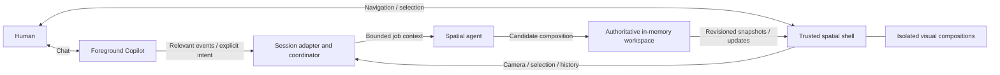

# Contextarium redesign — feasibility research

**Status:** Documentation and SDK source review, 2026-11-27. No live Copilot or browser experiments performed.  
**Companion:** [REDESIGN.md](REDESIGN.md), which remains authoritative for the agreed product experience.  
**Baseline:** [6121873](https://github.com/ericslandry/contextarium/commit/612187397783020bb55baaec156daa32153fde8b). The last recorded native acceptance used desktop 1.5.0, CLI 1.0.115-7, SDK protocol 4; current installed versions must be measured.

## 1. Executive recommendation

The proposed design is technically plausible. The most important discovery is a potential **native background execution mechanism: Copilot Dynamic Workflows**. GitHub documents background workflow runs, extension-triggered execution and Canvas integration. Investigate this before introducing a separate SDK runtime. It may solve scheduling and authentication more naturally, but its preview status, permission inheritance, availability in the installed client and suitability for small repeated updates are material uncertainties.

For rendering, start with **isolated, non-executable HTML/CSS/SVG documents inside a trusted spatial shell**, using sandboxed iframes with opaque origins and no script execution. Use a strict content/resource policy as a second boundary. Keep simple native elements and optional safe SVG image rendering available where useful. The key tradeoff is that an opaque frame's internal DOM cannot be inspected directly; address that through fixed authoring dimensions, bounded compositions, preview measurement and explicit metadata rather than relaxing isolation.

Use a session-scoped in-memory state manager and one logical composition writer. Separate scene revisions, conversation context freshness and human navigation epochs. Neither a new rendering framework nor persistent infrastructure is justified by the agreed initial scope.

**Do not start the redesign on the assumption that a foreground extension automatically has a privileged background-session factory, that preview workflows are already installed, or that script-free markup is safe.** The live tests below are the next gate.

## 2. Copilot integration: evidence and gaps

### 2.1 Evidence matrix

| Capability | Evidence | Remaining uncertainty |
|---|---|---|
| Join an existing session from an extension | Documented and implemented in SDK source [G1–G3]; existing plugin uses it | Exact installed version and session lifetime |
| Observe foreground events | Extension examples show session event subscriptions [G2]; event reference documents message/turn/idle events [G4] | Delivery in desktop Canvas host; ordering, replay, attachment scope and event visibility |
| Start independent SDK sessions | Public SDK client supports session creation, per-session model, tools and event handlers [G5] | Whether desktop-installed extension can start/authenticate a second runtime without additional setup |
| Native background orchestration | Dynamic Workflows run concurrently with interactive work and can be triggered through extensions [G6]; current extension source exposes workflow registration [G3] | Preview API support, permissions, cost, cancellation, session lifecycle and UI impact |
| Delegate to a custom agent | Custom agent and Fleet documentation [G7, G8] | Parent-turn dependency, actual independent progress, inherited tools and permissions |
| Limit spatial agent capabilities | Public SDK documents explicit tools and empty-mode runtime configuration [G9] | Exact names and behavior of installed-version options; workflow agents may inherit foreground permissions |
| Observe usage | Usage events, session metrics and account quota APIs [G10] | Availability and actual charges in target account; background work is not assumed free |
| Bundle a skill | Plugin format supports skills; SDK has explicit skill configuration [G11, G12] | Discovery under current legacy manifest; background worker skill loading and permission boundaries |
| Native Canvas open/close/actions | Existing Contextarium integration and public Canvas SDK [G13] | Exact wire protocol/version; newer source signatures differ from current plugin |
| Transient state | Application can own an in-memory workspace; SDK lifecycle APIs exist [G5, G14] | SDK may store transcripts or artifacts on disk even when Contextarium is transient |

Evidence means documented or visible in upstream source, not demonstrated on the user's installed app.

### 2.2 What the current extension actually does

The shipping entry point [extension.mjs](../plugins/contextarium/extensions/contextarium/extension.mjs) joins the foreground session and calls `session.send({mode: "enqueue", prompt: ...})` on an explicit canvas request. This creates work in that same session. It does not establish an independent spatial agent.

The upstream [extension implementation](https://raw.githubusercontent.com/github/copilot-sdk/main/nodejs/src/extension.ts) resolves the existing session ID from its environment and connects to the parent process. It returns a joined session, not a separately managed client factory. Its current type also includes experimental workflow registration and strips certain options reserved for the session owner. Do not use internal connection fields, extract tokens, access private RPCs or assume that an extension has owner-level privileges. The upstream repository and package naming are evolving; the inspected source redirects between GitHub and Microsoft namespaces. Use installed declarations and compatible released APIs, not a blind copy of main.

The official extension examples include observation of user and assistant messages, tool events and session idle. Start by subscribing to event metadata; capture completed user/assistant messages and useful boundaries, not hidden reasoning, token-by-token deltas or arbitrary tool results. `assistant.message` can occur within a tool-using turn; use turn/session boundaries to distinguish provisional content from useful completed responses. Filter by owning session, deduplicate events and never reflect the spatial agent's own traffic into its input.

### 2.3 Candidate background mechanisms, in recommended test order

| Candidate | Why consider | Why not assume it works |
|---|---|---|
| A. Native Dynamic Workflow | Documented background execution, extension registration and programmatic initiation; potentially reuses host auth and run controls | Preview; may require a newer client, inherits foreground grants, may expose workflow UI/results, could be expensive for frequent small jobs |
| B. Independent SDK session | Explicit lifecycle, scoped tools, model, context and scheduling; strong separation from conversation | Extra runtime/dependency/auth requirements; potential policy mismatch and disk persistence; desktop sign-in alone is not proof of CLI auth |
| C. Foreground custom subagent | Native delegation and isolated reasoning context | Usually initiated by parent task; may delay parent completion or need explicit delegation; insufficient evidence of continuous independent observation |
| D. Existing foreground queue | Proven current fallback, minimal dependencies | Adds turns to foreground session; does not meet nonblocking design objective |

**A: test first, not adopt unconditionally.** GitHub's [Dynamic Workflows concept](https://docs.github.com/en/copilot/concepts/agent-capabilities/agent-powered-workflows-and-operations/dynamic-workflows) says background runs can coexist with ongoing session work and can originate in extension tools/hooks or Canvas controls. The source registers workflow handles through the extension join options. A composition run could accept a bounded conversation/scene snapshot, perform one spatial-agent job, and return a structured candidate for the extension to validate and publish. This avoids exposing a background worker to the Canvas transport directly. Confirm the actual supported programmatic start, status, cancellation, structured result and tool scope on installed SDK; do not invent a method signature. Workflow-owned agents inherit existing session permission grants according to GitHub's documentation. This is a substantial concern: prove that the worker can be restricted to composition-only capabilities despite those grants, or reject this option. Also assess whether starting a workflow for a small scene change is excessive and whether visible workflow reports disrupt the desired unified UX.

**B: fallback with stronger capability separation.** Public SDK APIs support independent sessions, distinct model configuration, event subscriptions, abort and custom tools. GitHub documents stored CLI OAuth credentials and a separate local/bundled runtime path; it does not prove that desktop extension processes can reuse the app's login without configuration. Probe using supported SDK entry points and the signed-in user only. No credential copying or broad token requests. Prefer an explicitly restricted runtime (the current docs describe empty mode), only narrowly scoped composition tools, deny-by-default permission handling, no inherited shell/repository/MCP access, no ambient skills or recursive plugin loading. Explicitly supply the composition skill. Confirm the actual available tool list, memory behavior, model availability, storage and shutdown. Avoid granting all tool requests as sample code often does.

**C: useful baseline, not the preferred autonomous architecture.** A custom agent can be valuable for explicit delegation, but the parent may wait for completion. Fleet is intended for decomposable parallel work and is not an obvious match for a continuous shared workspace. Do not convert a simple spatial update into an elaborate multiagent orchestration solely to use Fleet.

**D: retain only as a disclosed fallback.** Existing enqueue behavior is a useful compatibility path, not evidence of asynchronous independent reasoning. A deterministic background provider can validate the rest of the architecture even when live-model integration is blocked.

### 2.4 Authentication, scope, privacy and cost

- Background processing must respect the foreground session's account and organizational policy. Do not assume a second CLI login, API key, BYOK service or separately billed account is acceptable.
- Forward only relevant conversation text and minimal contextual state. Do not automatically transfer attachments, file contents, secrets, entire tool transcripts or hidden reasoning. Explicitly assess data classification and content exclusion.
- Treat external and displayed content as untrusted data, including indirect prompt injection. Enforce composition-only output with code-level authorization and validation, not prompt wording alone.
- Do not start background reasoning merely because the plugin is installed. Activation should be apparent to the human; support pausing background composition. This is a proposed safeguard for the continuous-update UX, not an agreed new product feature.
- Keep one active spatial job per owning session initially; coalesce relevant events, limit update frequency, context/output size and job duration. Do not invoke on every message delta, selection or zoom event. Explicit user intent is prioritized.
- Use `assistant.usage` or supported aggregate usage metrics and account quota observations where available [G10]; record the actual billing units exposed by the host. There is no evidence that an independent job is free or shares a single foreground request charge. Limit tests and use synthetic data.
- A transient Contextarium workspace does not imply a transient Copilot transcript. Verify SDK-generated session files, logs and workflow artifacts, retention and supported cleanup [G14]. Do not delete the user's foreground session or existing history. Background session cleanup must target only resources created by the plugin.

## 3. Rich visual compositions

### 3.1 Options

| Rendering mechanism | Creative range | Isolation | Implications for Contextarium |
|---|---|---|---|
| Direct HTML/CSS/SVG fragments in main DOM | Excellent | Weak unless substantial filtering | Easy inspection and navigation, but CSS and markup can affect trusted controls; broad sanitizer burden |
| Shadow DOM | Excellent | Style encapsulation, not a security boundary | Useful for trusted native widgets; does not by itself prohibit scripts, requests or all escape/interaction paths |
| Sandboxed iframe, opaque origin | Excellent for static and animated markup | Strongest practical browser-native starting point | Separate document styles; explicit dimensions and spatial wrapper; parent cannot directly inspect inner layout; frame overhead |
| Sandboxed iframe, same origin but scripts disabled | Excellent | Weaker than opaque-origin isolation | Parent can measure internal DOM; avoid for first prototype because shared origin and future misconfiguration increase risk |
| SVG as an image | Excellent for vector illustration; limited general HTML/text layout | Restricted image context | Useful inexpensive rendering path; no native internal hit testing, verify browser-specific restrictions and reject unsafe asset types |
| Raster snapshot | Arbitrary visual appearance | Image-only display | Simple and potentially fast at overview, but loss of selectable text and sharpness at deep zoom; generation/cache complexity |
| Agent-generated executable application | Maximum | Depends on robust sandbox | Explicitly deferred by product decision |

References: iframe and srcdoc semantics [B1, B2], Shadow DOM [B3], SVG image restrictions [B4], same-origin policy [B5].

**Preferred first experiment:** a trusted spatial shell hosting sandboxed iframe documents with no sandbox allowances. Agent-authored HTML/CSS/SVG can use normal typography, flex/grid, shapes, gradients, paths and CSS animation. The trusted shell positions and scales each composition and owns navigation, opacity, z-order, selection and transitions. Native content can remain as an optional convenience, not a restrictive catalog.

### 3.2 Security boundary

An iframe with an empty sandbox attribute disallows script execution and grants an opaque origin by default. Do not add allow-scripts, allow-same-origin, allow-forms, allow-popups, allow-downloads or navigation escape permissions. This is not by itself a network egress or resource-exhaustion boundary.

Test two delivery mechanisms:

1. A trusted wrapper document supplied through srcdoc, with restrictive CSP before agent content. This is a small first probe. Relative URL resolution and inherited parent CSP matter; do not treat srcdoc as trusted markup or its base URL as safe.
2. A dedicated local composition response, generated by trusted code, with HTTP CSP headers including sandbox; serve it from an isolated content origin where practical, with no host API or credentials. This may give better header enforcement and predictable policy, at the cost of additional local serving and host compatibility. Never serve unsafe raw content as an unrestricted directly navigable document.

Illustrative restrictive document policy (not a finalized policy):

```text
default-src 'none';
script-src 'none';
style-src 'unsafe-inline';
img-src data:;
font-src 'none';
connect-src 'none';
object-src 'none';
frame-src 'none';
base-uri 'none';
form-action 'none';
```

Permit data images only if actually needed and after MIME/size validation (prefer verified raster formats initially). If no embedded assets are required, omit that allowance. Inline styling is deliberately permitted for creative expression; do not permit external stylesheets, font fetches, remote SVG references or arbitrary network access. Use HTTP sandbox directive when serving a document; it is not supported as a CSP meta directive [B6]. Configure the trusted shell's frame policy separately and narrowly. Consider Permissions-Policy to disable unnecessary device features [B7]. Avoid broadening the existing loopback bridge's origin policy.

Construct the trusted document envelope yourself. Parse and validate content structurally; never use a regex-only sanitizer or insert raw markup into the host DOM. Disallow active document features: scripts and event attributes, nested frames/objects/embeds, external or navigable links, forms, base elements, meta refresh, remote references and other resource loaders. SVG links, foreignObject, animation-driven changes to URL-bearing attributes, CSS url()/imports, SVG filters and data URLs require deliberate assessment. Use local fragment references where needed for gradients/clips/masks; validate those independently from external URLs. Sandbox alone does not prohibit all in-frame navigation or subresource requests. A tested combination of browser enforcement, limited input, resource restrictions and structural checks is needed.

No composition may issue a host command, access a bridge capability, submit a prompt or masquerade as a trusted system control. Keep navigation controls and agent status in trusted shell UI, outside clipping/z-order control of compositions. Do not provide privileged messaging from arbitrary frame origins. If future interaction requires a bridge, design a separate capability protocol; agent JavaScript remains out of scope.

Bound source bytes, document count, DOM/geometry complexity, embedded asset bytes/dimensions, animation duration/count and rendering workload. A sandbox does not guarantee CPU/GPU isolation or prevent browser engine vulnerabilities. Use visibility-aware loading, animation pause/reduced-motion policy and a recovery path for invalid or unresponsive content. Measure rather than declare iframe isolation sufficient.

### 3.3 Spatial model and tradeoffs

A composition should be designed against a local viewport, for example 1600 × 900 CSS design units, but dimensions are authored and need not be standardized. A trusted wrapper controls actual world placement and scale. Parent transforms map local coordinates to world coordinates. The camera maps world coordinates to screen coordinates. Changing the camera does not reflow or regenerate the content.

Use a stable object ID and separate transform/content revision. Moving or fading an object should not reload its frame. Replace the internal content only when necessary; retain outer identity and geometry. Use candidate publication as a single coherent state change; stage expensive frames where practical. No mandatory native schema for every shape.

Conceptual math:

```text
worldScale(node) = worldScale(parent) × localScale(node)
worldPosition(node) = worldPosition(parent) + worldScale(parent) × localPosition(node)
screenPosition = viewportCenter + cameraScale × (worldPosition - cameraCenter)
```

Actual bounds include the node's scaled dimensions. Test several successive 10× zoom levels; use effective local zoom (camera scale × cumulative world scale) for detail disclosure. Consider camera-relative coordinates, culling and level-of-detail if deep scale exposes precision or browser transform limits. Avoid blindly inheriting the old 16× zoom maximum or adopting CSS nested transforms without testing. The current renderer avoided certain compositor optimizations due to Chromium clipping; reproduce the relevant stress cases.

Opaque frames complicate hit testing and measurement. Initially use a trusted hit surface above each frame (or pointer-events:none on the frame) for reliable pan/zoom/selection. Keep keyboard focus in the trusted shell for navigation. This matches deferred content-level interaction, but can restrict native text selection, scrolling and accessibility. Test text-heavy use explicitly; provide a safe reading/selection mode or accessible companion text if necessary. Do not compromise camera takeover or grant active content privileges merely to enable text selection.

Optional semantic anchors can be supplied as local bounding rectangles and names, independent of internal markup. These need not be mandatory or implemented for the first probe. Native cross-composition connectors may be valuable when endpoints need to survive moves; internal connectors may remain authored SVG. A full routing engine or graph schema is not required.

### 3.4 Validation and authoring implications

An opaque iframe's internal DOM cannot be read by the parent. The existing layout validator relies on direct DOM geometry, so it cannot simply be reused unchanged. This is a real architectural tradeoff, not a reason to reduce creative freedom.

Distinguish three checks:

- **Mandatory structural/security validation:** valid IDs and bounds, budgets, safe content policy, references, serialization and authorization.
- **Spatial validation:** world bounds, intended visibility, layering, camera focus, composition-level overlap and viewport fit. Overlap may be intentional; do not impose blanket card-grid rules.
- **Visual quality:** readability, clipping and meaning inside compositions. Use browser automation in a controlled preview/test context for inner DOM metrics if supported, visual screenshots where appropriate and agent-supplied authoring metadata. Do not give untrusted content scripts or same-origin access merely to recover live layout measurements. If testing uses a privileged automation channel, keep it out of the production interface.

The earlier label readability warning illustrates the need for calibrated recipes: 18 design-unit text in a 1600-wide board fitted into a 1000-wide viewport with 80 units of horizontal margin projects to 10.35 CSS px, below the current 12 px focused threshold. Calibrate actual available viewport including HUD/toolbar and use intended viewing mode. Distinguish overview recognizability from focused readability. Validate representative examples rather than prescribing a universal visual density.

## 4. Proposed architecture and state coordination

These are recommended design boundaries, not finalized schema/API choices.



Maintain three different notions of freshness:

| Domain | Owner | Purpose |
|---|---|---|
| Workspace revision and generation | State manager | Atomic accepted mutations, reset/import fencing, renderer sync |
| Conversation context sequence / job generation | Coordinator | Suppress obsolete model results after conversation advances |
| Human navigation epoch | Browser | Veto stale camera guidance after manual takeover |

A job receives a scoped immutable snapshot of relevant conversation context, current workspace revision and current human presentation context. It may return a candidate or no change. The coordinator checks session identity, current generation, revision and relevance before publication. Rebase only if safe; otherwise discard or recompute. The workspace manager is the single commit authority; the agent is not a direct writer to browser DOM. A stale camera request can be rejected independently of valid content changes.

Use one full snapshot on connect/reconnect and bounded revisioned deltas or snapshot replacements thereafter. Test deterministically before optimizing transport. Reuse loopback HTTP/SSE only if its security and delivery semantics fit the new boundary. Keep the renderer independent of Copilot-specific APIs and treat browser events as untrusted. Validate exact renderer registration and session ownership. Avoid multiple services, databases, generalized message brokers, complex operational transforms or event-sourcing for the transient single-user product.

Export a versioned self-contained workspace artifact, including content and spatial structure, with no capability tokens, credentials or hidden chat transcripts. Validate imported content just like agent-generated content. Decide whether camera/viewpoint is an optional export field; no full navigation-history persistence required. Import invalidates in-flight job generations. SDK persistence is a separate concern.

Navigation history should track meaningful completed viewpoint changes, not every animation frame. Store camera coordinates and optional target identity, handle removed targets gracefully, and preserve Back/Forward semantics when new navigation branches. A direct user-requested movement is always permitted; agent guidance is independently vetoable. Breadcrumbs should follow meaningful composition ancestry where known, not pretend there is a hierarchy when none was authored.

## 5. Bundled skill and installation

The current manifest uses the legacy Copilot-specific extension path. Official plugin docs support a root skills directory in the legacy format [G11]. First test `skills/contextarium/SKILL.md` with name/description frontmatter and optional references/examples, retaining working packaging. The newer Agent Plugins format is not automatically a better fit for executable Canvas extensions; verify compatibility before migrating.

For the background provider, use a supported explicit skill directory or narrowly scoped instructions and read-only reference access [G12]. Do not assume that plugin installation automatically injects the skill into a separate runtime or workflow-owned agent. Skills guide model behavior and do not grant tools or permissions. Test native discovery from a fresh session without a checkout. The installed skill must reflect the eventual new workspace interface, not encode the old seven-widget catalog.

Use examples as creative starting points, including text-heavy and diagram-heavy compositions, and make them visual regression fixtures. Favor a short default guide, inspect/compose/validate/publish workflow and minimal repetitive calls.

## 6. Targeted handoff: Work validation protocol

### Gate 0 — zero-model-call environment inventory

- Record desktop, CLI, Node, extension SDK package name/version, protocol and browser/WebView versions. Locate supported installed type declarations and examples for joinSession, event subscriptions, Canvas declarations, workflows, session creation, tools and permission controls. Do not print tokens, environment variable values or transcripts.
- Check existing plugin packaging, update lifecycle and native Canvas loading in a fresh session. Do not alter the shipping plugin or default branch. Use a small disposable probe or isolated branch, deterministic fixtures and the existing installed-app test environment.
- Verify feature presence and signatures; compare against upstream documentation. If workflow APIs are absent, document that and proceed to the independent-session probe without upgrading the user's app unilaterally.
- No Copilot model prompts (including background jobs) until explicit approval. Native UI operations and deterministic tests are permitted.

### Gate 1 — foreground observation (F1)

Register a passive observer on the joined session. Record timestamps, event type, correlation IDs, owning session, counts and redacted synthetic markers; use stderr or a bounded test log, never stdout. Confirm registration, unsubscribe, close and session replacement. If live user/assistant events require prompts, stage the probe and request approval for a minimal synthetic run.

Pass: correct ordered/attributable conversation events in a real desktop session, completion boundaries understood, no cross-session leakage or recursive self-observation. Record replay/duplicates and whether extension startup misses earlier conversation context. Fail: only unavailable/private APIs or unacceptable scope needed.

### Gate 2 — background runtime (F2; highest-risk integration gate)

A. Inspect and, if supported, register a minimal Dynamic Workflow via the extension. First run deterministic code only if the runtime permits it. Determine supported invocation, result retrieval, status, cancellation, inherited permissions and UI behavior. Verify it runs in the background without submitting a chat message. Then stage a single scoped spatial-agent step, awaiting explicit approval.

B. If A is unavailable or unsuitable, instantiate a supported independent SDK client/runtime using existing authorized credentials. Check status, auth identity, available models, actual tools/skills and lifecycle without a model turn where possible. Ensure no recursive extension activation or foreground-session takeover. If extra login, installation, dependencies or approval is required, report it rather than bypassing it.

For the selected candidate, request one tightly scoped approved live experiment: start a minimal background composition job and demonstrate an ordinary foreground conversation operation while it is in flight. Compare baseline and concurrent foreground time to first meaningful response and completion, log background duration, host-visible artifacts and actual available usage counters. A mocked job is useful for scheduling but does not establish model concurrency. If two live turns or more are necessary, request the exact budget first.

Pass: foreground remains independently usable, no unwanted injected chat turns, correct authorized account, bounded/scoped worker, cancellation and cleanup, credible usage visibility. Fail: blocking/mandatory additional account setup, unrestricted inherited privileges, private API dependence or unacceptable UX/cost. A preview API may still be an acceptable experimental dependency only after explicit decision.

### Gate 3 — state and independent rendering (F3, F5)

Use deterministic jobs to demonstrate a scene update while the foreground is active (or simulated). Implement a tiny authoritative in-memory state probe, with full reconnect snapshot, revisioned mutation and separate camera epoch. Test a delayed obsolete result, two sessions, import/reset while a job is running, duplicate/reordered delivery, renderer disconnect and close. Confirm human camera takeover persists even when content changes. Export/import the test scene without secrets.

Pass: no stale mutation, no cross-session update, atomic/coherent publication, reliable reconnect and teardown. No durable database or complex concurrency framework.

### Gate 4 — browser isolation and spatial quality (F4, F7)

Use identical synthetic compositions across a standalone Chromium/Edge test and the actual Canvas WebView. Compare sandboxed srcdoc and dedicated restrictive-response rendering if needed. Include rich SVG with gradients/paths/masks, styled HTML text, a table and CSS animation. Place several distinct compositions in a shared world with different scales and test repeated 10× zoom, pan, transitions, overlap, selection, resize and content replacement. Cover at least 440×650, 520×980 and 1000×750 viewports. Verify reduced-motion behavior, legible focused text, keyboard navigation and accessibility tradeoffs.

Adversarial synthetic cases: attempted script/inline handler, navigation/meta refresh, forms, nested frames, remote CSS/image/font/SVG references, URL-bearing SVG animation, cross-frame access, malicious UI imitation, oversized markup and expensive animations/filters. Observe a controlled local request sink and browser policy errors; no external services or real secrets. Demonstrate no unwanted requests, no host DOM mutation, no prompt or bridge side effect, and bounded failure. Verify direct-navigation restrictions as well as embedded behavior. Test parent CSP interactions and actual WebView capabilities.

Measure first render, pan/zoom frame times (including p95), memory/DOM/frame counts and recovery when hidden/offscreen compositions accumulate. Compare a small and a moderately populated scene, e.g. 5 and 20 rich compositions; set concrete release budgets after measurements. Record visual evidence at meaningful zoom levels. Test whether text selection/scrolling and internal layout measurement are worth additional safe mechanisms; do not weaken isolation to pass a visual test.

Pass: expressive distinct compositions, seamless camera movement, trusted navigation, acceptable measured resource use, explicit blocked capabilities. Report any browser limitations and viable fallback (e.g. SVG image path) instead of pretending all HTML/CSS features work.

### Gate 5 — skill packaging and final evidence (F6, F7)

Add a minimal non-executable test skill to the isolated probe package. Verify native discovery, installation/update/uninstall and fresh no-repository session. Confirm it is available in the selected background mechanism and has only intended resource/tool access. A discovered skill listing is not proof that the model follows or can load it; test with approved live budget only if needed.

Deliver a concise decision record for each gate: versions, supported API signatures, test procedure, observations, evidence paths, usage, pass/fail/blocked, remaining security limitations, and recommended architecture. Do not merge probe code or implement the full redesign until material feasibility decisions are reviewed.

## 7. Decisions we can make now versus later

| Decide now | Decide after evidence |
|---|---|
| Content-agnostic spatial shell; optional semantic metadata | Exact content and spatial schema; anchor/connector needs |
| No agent-generated executable content | Rich markup delivery/isolation strategy and measured budgets |
| Separate authoritative workspace and browser presentation state | Final transport and serialization details |
| One composition authority with freshness fencing | Workflows versus independent SDK runtime, scheduling thresholds |
| Creative skill rather than mandatory layout templates | Installed skill discovery and efficient real model workflow |
| Local transient lifecycle with manual import/export | SDK transcript/workflow artifact retention and cleanup |
| Human camera precedence and navigation recovery | Detailed camera/history and tour/reveal mechanics |

Security issue [#5](https://github.com/ericslandry/contextarium/issues/5) remains open. Reassess its renderer identity, prompt injection, resource limits, human authority, CSP and supply chain findings when choosing boundaries. Review native plugin update trust and reused code provenance independently of browser isolation.

## 8. Source register

Public upstream documentation and source inspected on 2026-11-27. These links may evolve. Installed package declarations and observed behavior take precedence for compatibility; pin the tested versions/commit in the subsequent validation report. The upstream Dynamic Workflow implementation file could not be retrieved directly in this review; its registration surface is visible in extension.ts and its user-facing behavior is documented. No unsupported invocation signature is asserted here.

**GitHub Copilot**

- G1 — [Node extension overview](https://github.com/github/copilot-sdk/blob/main/nodejs/docs/extensions.md)
- G2 — [Extension event examples](https://github.com/github/copilot-sdk/blob/main/nodejs/docs/examples.md) and [extension authoring reference](https://github.com/github/copilot-sdk/blob/main/nodejs/docs/agent-author.md)
- G3 — [Extension joinSession source](https://raw.githubusercontent.com/github/copilot-sdk/main/nodejs/src/extension.ts)
- G4 — [Session event reference](https://docs.github.com/en/copilot/how-tos/copilot-sdk/features/streaming-events) and [agent loop](https://docs.github.com/en/copilot/how-tos/copilot-sdk/features/agent-loop)
- G5 — [SDK compatibility](https://docs.github.com/en/copilot/how-tos/copilot-sdk/troubleshooting/compatibility), [client source](https://github.com/github/copilot-sdk/blob/main/nodejs/src/client.ts), [authentication](https://docs.github.com/en/copilot/how-tos/copilot-sdk/auth/authenticate), [local CLI setup](https://docs.github.com/en/copilot/how-tos/copilot-sdk/setup/local-cli)
- G6 — [Dynamic Workflows concept and availability](https://docs.github.com/en/copilot/concepts/agent-capabilities/agent-powered-workflows-and-operations/dynamic-workflows), [usage guide](https://docs.github.com/en/copilot/how-tos/use-copilot-agents/use-dynamic-workflows)
- G7 — [Custom agents and subagents](https://docs.github.com/en/copilot/how-tos/copilot-sdk/features/custom-agents)
- G8 — [Fleet mode](https://docs.github.com/en/copilot/how-tos/copilot-sdk/features/fleet-mode)
- G9 — [SDK runtime isolation and tools](https://docs.github.com/en/copilot/how-tos/copilot-sdk/setup/multi-tenancy)
- G10 — [Usage and billing metrics](https://docs.github.com/en/copilot/how-tos/copilot-sdk/features/usage-and-billing), [session limits](https://docs.github.com/en/copilot/how-tos/copilot-sdk/features/session-limits)
- G11 — [Plugins](https://docs.github.com/en/copilot/concepts/customizations/plugins), [desktop customization](https://docs.github.com/en/copilot/how-tos/github-copilot-app/customize-github-copilot-app)
- G12 — [SDK custom skills](https://docs.github.com/en/copilot/how-tos/copilot-sdk/features/skills), [plugin directories](https://docs.github.com/en/copilot/how-tos/copilot-sdk/features/plugin-directories)
- G13 — [Canvas extension documentation](https://docs.github.com/en/copilot/how-tos/github-copilot-app/working-with-canvas-extensions), [Canvas source](https://github.com/microsoft/copilot-sdk/blob/main/nodejs/src/canvas.ts)
- G14 — [Session resume/persistence](https://docs.github.com/en/copilot/how-tos/copilot-sdk/features/session-persistence), [session data](https://docs.github.com/en/enterprise-cloud@latest/copilot/concepts/security-governance-and-network-settings/session-data)

**Browser platform**

- B1 — [iframe element and sandbox](https://developer.mozilla.org/en-US/docs/Web/HTML/Reference/Elements/iframe)
- B2 — [srcdoc](https://developer.mozilla.org/en-US/docs/Web/API/HTMLIFrameElement/srcdoc)
- B3 — [Shadow DOM](https://developer.mozilla.org/en-US/docs/Web/API/Web_components/Using_shadow_DOM)
- B4 — [SVG in image contexts](https://developer.mozilla.org/en-US/docs/Web/SVG/Guides/SVG_as_an_image)
- B5 — [Same-origin policy](https://developer.mozilla.org/en-US/docs/Web/Security/Defenses/Same-origin_policy)
- B6 — [CSP header](https://developer.mozilla.org/en-US/docs/Web/HTTP/Reference/Headers/Content-Security-Policy), [sandbox directive](https://developer.mozilla.org/en-US/docs/Web/HTTP/Reference/Headers/Content-Security-Policy/sandbox), [frame-src](https://developer.mozilla.org/en-US/docs/Web/HTTP/Reference/Headers/Content-Security-Policy/frame-src)
- B7 — [Permissions Policy](https://developer.mozilla.org/en-US/docs/Web/HTTP/Guides/Permissions_Policy)
