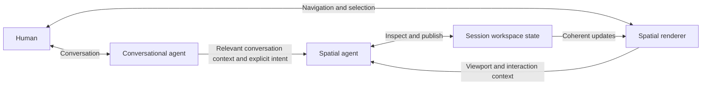

# Contextarium redesign

**Status:** Agreed product direction; proposed target architecture pending technical feasibility validation.  
**Baseline:** Contextarium v0.2.0, commit [84c0a12](https://github.com/ericslandry/contextarium/commit/84c0a12486def4dd7b9e10032becce9fcef49dfd).  
**Scope:** Clean redesign, not an incremental extension of the existing component catalog.

This document records the decisions reached during product discovery and identifies the remaining technical questions. It describes the intended future product, not the current implementation. The existing architecture, contracts and development instructions remain applicable to the shipping implementation until the redesign is adopted.

## 1. Product vision

Contextarium is a living spatial workspace in which a human and AI collaboratively develop understanding.

The workspace is the primary artifact; conversation is a means of developing it. It is not merely a dashboard, generated presentation, slide deck or visualization of a chat transcript. The user should experience a single cohesive assistant, regardless of how many internal agents participate.

The subject and the evolving understanding should determine the visual language. Contextarium should be equally comfortable with text, diagrams, illustrations, tables, charts, spatial relationships, motion and combinations of these. No predefined visual pattern or component catalog should determine what an agent is capable of expressing.

## 2. Agreed user experience

| Dimension | Decision |
|---|---|
| Evolution | The agent continuously curates the workspace as the conversation develops. |
| Composition | Agents author and modify the workspace; the human does not directly edit its contents. |
| Human interaction | Navigation, zoom, selection and conversation are sufficient for the initial product. |
| Navigation as intent | Passive exploration is a low-weight contextual signal, not an instruction or an automatic reason to invoke an agent. Explicit requests take precedence. |
| Attention | The agent may actively guide the camera when useful. The human can immediately take control. |
| Navigation recovery | Back and forward restore prior viewpoints; breadcrumbs show conceptual ancestry where available; overview restores broader context. Navigation history is not content undo. |
| Spatial continuity | Prefer retaining recognizable landmarks and relative placement, but allow reorganization when it improves understanding. |
| Content lifecycle | Curate the current understanding. Remove, hide or fade obsolete or less relevant material; retain earlier information selectively when useful. No formal archival layering or knowledge management system. |
| Creative expression | Maximum freedom within the supported content and execution boundaries. Example patterns are optional inspiration, not mandatory templates. |
| Theme | Offer a convenient default visual theme that agents may override. |
| Information density | No preference for graphics over text or vice versa; choose the medium appropriate to the subject. |
| Publication | Update progressively where useful; prepare coherent substantial compositions before revealing them. Do not expose every intermediate construction step. |
| Animation | Animate meaningful changes and narrative transitions; routine updates may be immediate. |
| Context awareness | Provide workspace, viewport, camera, selection and recent navigation/interaction context to the agent. Interest inference is weak and must not override explicit intent. |
| Chat versus canvas | Adapt between chat, canvas or both. Avoid unnecessary duplication. |
| Responsiveness | Spatial composition should not unnecessarily block conversational interaction. |
| Lifetime | A transient workspace per Copilot session, with manual save/export and import. Transparent persistence and cross-session synchronization are deferred. |

### Illustrative experience

During a discussion of a system architecture, the workspace begins with a coherent overview. As the human and AI explore a subsystem, the agent enriches the existing landscape, highlights the relevant relationships and may guide the camera toward a discovery. The human can return to the previous viewpoint, navigate independently, or ask about the current selection in natural language. If a hypothesis is disproved, the agent may remove it or retain it with appropriate visual de-emphasis. The chat remains responsive while visual composition takes place.

The same experience should work for a text-heavy legal discussion, an illustrated scientific explanation or a conceptual map. This example does not prescribe a layout or domain.

## 3. Agreed architecture direction

### 3.1 Content-agnostic spatial engine

Replace the widget catalog as the boundary of expression with a hybrid spatial composition model:

- The agent owns visual expression and determines what to represent and how to represent it.
- Contextarium owns spatial placement, identity, navigation, presentation mechanics and the controlled workspace interface.
- Rich compositions may contain independently authored HTML, CSS and SVG. Simple native elements remain available when convenient. Both should feel like parts of one spatial environment.
- By default, the engine treats the internal visual content as opaque. It need not understand the subject matter or every visual element.
- Optional semantic anchors may expose meaningful regions or entities for selection, reference and navigation. Sophisticated internal manipulation and anchor semantics can wait for a concrete need.
- A minimal spatial contract is expected to cover stable identity, geometry and scale, content, visibility/opacity and relationships as needed. Exact fields, formats and protocols are deliberately not specified yet.
- No agent-supplied executable JavaScript in this iteration. Trusted runtime code remains responsible for spatial behavior and integration. Allow future consideration of sandboxed programmable compositions without requiring them now.

Rich content must be isolated from the workspace, privileged host and other compositions. Non-executable markup is not inherently safe: HTML, CSS and SVG still require explicit handling of active features, resource loading, external references, UI spoofing and resource consumption. Select and test the actual isolation mechanism before fixing the content contract. Security should constrain capabilities and trust boundaries rather than unnecessarily limiting visual expression.

### 3.2 Spatial navigation and narrative

Support a genuinely multiscale environment rather than a collection of same-size rectangles. Preserve the useful cinematic movement of the Spatial Explainer reference where appropriate.

The intended experience includes smooth zoom and camera flights, progressively revealed detail, meaningful transitions, navigation recovery and optional guided narrative sequences. Native relationships, connectors, semantic zoom, captions and tour controls are candidate mechanisms, not a commitment to the earlier proposed v2 schema. Rich content may itself provide many visual relationships without dedicated widget types. Validate the need for each native primitive against the UX.

Human camera authority is an invariant. Agent guidance is permitted until the human takes control. Manual takeover must cancel or veto competing automatic movement; agent content changes must not silently reset that authority. Returning to a viewpoint does not roll back content. Resume behavior should be explicit and understandable.

### 3.3 Separate workspace and presentation state

A session-scoped state manager owns authoritative workspace content and spatial structure, with revisions or equivalent synchronization metadata. This may be an in-memory module within the plugin process; a database or independent network service is not required.

The browser owns live presentation state: camera, navigation history, selection and user interaction. Agents access workspace and presentation context through controlled interfaces. The renderer consumes workspace updates and reports relevant presentation events. Do not make either agent's conversational context the authoritative workspace.

Use coherent updates, conflict detection and stale-work fencing. Define import/export semantics and restoration behavior during design; do not confuse transient synchronization metadata with durable history or archival storage.

### 3.4 Asynchronous spatial composition

The desired experience is one cohesive assistant with two internal responsibilities:

The conversational agent develops understanding with the human. The spatial agent observes relevant conversation context and independently determines useful visual changes. It also accepts explicit visualization requests from the conversational agent. The spatial agent is the composition authority; the two agents should not compete as independent workspace writers.

The spatial agent should preserve useful in-flight work where possible and adapt or discard work that becomes irrelevant as the conversation advances. Avoid processing every event as a new model invocation. Passive navigation alone is not an automatic prompt trigger. Coalesce updates and prevent late results from overwriting newer understanding or interrupting human navigation.

A Copilot child session, independent SDK session or other supported background mechanism is a technical hypothesis, not a verified feature of the installed Canvas host. The exact context transfer, scheduling, authentication, model selection and cancellation mechanism remain open. If the proposed background mechanism is infeasible, report the constraint and assess alternatives against the responsiveness objective rather than silently substituting a blocking queued-prompt design.

### 3.5 Bundled agent skill

Distribute a dedicated Contextarium skill through the native plugin, subject to validating skill discovery in the actual installed host.

The skill should teach composition judgment, not enforce visual templates. Include illustrative spatial storytelling patterns (overview/drilldown, guided narratives, exploration maps and other useful approaches), reusable tested layout/coordinate recipes, navigation and animation guidance, and efficient inspect/compose/validate/publish workflows appropriate to the redesigned interface.

Reference scenes should exercise the real runtime and serve as regression fixtures. Examples must remain optional. Avoid requiring agents to rediscover contracts, emit large amounts of boilerplate or default to repetitive grids. Validate representative viewport sizes and meaningful zoom levels; do not simply suppress valid readability warnings.

The existing v1 authoring guide and tool sequence are useful evidence, but the new skill should follow the redesigned contract rather than perpetuate obsolete tools or assumptions.

## 4. Scope and deferred capabilities

Initial scope includes the transient spatial workspace, rich non-executable visual compositions, simple native elements, ongoing agent composition, camera guidance and recovery, contextual awareness, adaptive updates and manual import/export. Asynchronous composition is a major objective whose feasibility must be established early.

Deliberately deferred:

- Agent-authored executable JavaScript, simulations and programmable interactive applications.
- General content-level filtering, parameter manipulation and advanced exploratory interactions.
- Human direct editing or collaborative visual authoring.
- Formal historical layering, undo of the knowledge state, durable persistence, cross-session synchronization and interconnected knowledge spaces.
- Sophisticated semantic anchors where no concrete need has been established.
- Public or remote multi-user hosting.

Avoid unnecessary architectural barriers to future capabilities, but do not implement speculative abstractions solely to accommodate them.

## 5. Migration strategy

**Clean redesign**: derive the architecture from the agreed experience, not from the existing schema or directory structure. Reuse proven camera interpolation, adaptive background, rendering techniques, validation ideas, transport and native packaging only where they fit the new architecture.

Do not assume v1 compatibility, the seven widgets, browser-owned workspace state or the current canned prompt behavior are permanent requirements. Explicitly assess migration/import of existing scenes and any compatibility or breaking-change decisions before release; do not remove support silently. Preserve the working installed plugin until replacement is validated, retain historical validation evidence, and favor native plugin lifecycle compatibility and stable product identifiers.

The existing implementation and security findings remain useful references. [Security hardening issue #5](https://github.com/ericslandry/contextarium/issues/5) must be reassessed against the redesigned trust boundaries: carry forward applicable mitigations, verify which defects disappear with the old architecture, and track new risks. Do not assume isolation or prompt instructions alone establish security. Preserve provenance and verify rights to reused Spatial Explainer material before redistribution.

## 6. Technical feasibility mandate

Before product implementation, run small, independently testable experiments that answer the following. These are proposed validation tasks and acceptance evidence, not claims that the mechanisms already work.

| Experiment | Questions and required evidence |
|---|---|
| F1. Conversation observation | Can the installed Canvas extension obtain relevant user/assistant events, including ordering, completion and session identity? Check actual event availability, permissions and context boundaries. Demonstrate correct filtering across sessions. |
| F2. Independent Copilot reasoning | Can a child or independent SDK session authenticate, use permitted models and reason concurrently without blocking or injecting turns into the primary chat? Measure responsiveness, usage and cancellation. Identify host/API/version constraints. |
| F3. Independent canvas updates | Demonstrate a background provider updating a visible canvas while the primary conversation continues. Validate revision fencing, obsolete results, disconnect/reconnect and session teardown. Confirm human camera takeover remains effective. |
| F4. Rich content isolation | Render representative independently authored HTML/CSS/SVG compositions in a shared multiscale space. Test zoom, clipping, typography, selection, opacity, transitions and inter-composition styling. Verify that scripts, event handlers, navigation, external resource access and host access are blocked as intended, with bounded resource consumption. |
| F5. State and synchronization | Demonstrate an in-memory authoritative workspace, incremental updates, coherent publication, renderer reconnect and manual export/import. Validate rejection of malformed/stale updates and independent presentation state. |
| F6. Skill and native lifecycle | Verify bundled skill discovery and access to spatial tools on the actual Copilot client, along with native install/update and a fresh session without repository-specific scaffolding. |
| F7. Experience and authoring | Compare a freely composed architecture explanation and a contrasting text-heavy or illustrated subject. Validate readability at realistic wide/narrow viewports, multiscale navigation, smooth meaningful transitions, and useful authoring efficiency. Measure calls, latency and visual quality rather than relying only on structural layout checks. |

Prioritize F1–F4 because the background integration and rich-content isolation could materially change the architecture. Use deterministic providers for routine experiments. Live model prompts consume the user's limited Copilot allowance; obtain explicit approval before submitting any such prompts. Record versions, exact test procedures, observations, failures, assumptions and unresolved questions. Do not interpret a mock or documentation example as successful live-host validation.

Feasibility work should not prematurely replace the existing implementation. Small disposable probes are acceptable evidence gathering for a clean redesign, not a competing product or a commitment to maintaining parallel architectures.

## 7. Implementation strategy and decision gates

1. **Formalize** — agree on this product vision and target boundaries. This document is the discovery baseline.
2. **Validate feasibility** — perform the experiments above; record results and recommend an integration and isolation approach. Escalate material conflicts with agreed UX or security boundaries.
3. **Design** — finalize the workspace contract, content isolation model, state authority, background coordination, navigation/history semantics, API boundaries, skill packaging, security threat model and migration plan. Separate verified facts from assumptions.
4. **Implement** — cleanly redesign the product in reviewable increments, incorporating proven code where appropriate. Establish deterministic and live-host acceptance tests and maintain native installation/update.
5. **Release** — demonstrate the agreed experience in representative scenarios, document limitations and migration, review security and provenance, and consolidate documentation around the adopted architecture.

No final implementation schema, framework, package layout, release version or timeline is prescribed here. Decide these after feasibility, with the smallest architecture that meets the user experience.

### Product-level acceptance

- A conversation can develop a coherent, expressive spatial workspace without a mandatory widget catalog or slide-deck aesthetic.
- The agent can modify independently addressable content and preserve spatial continuity where useful.
- Agent guidance, user navigation, back/forward, overview and meaningful breadcrumbs coexist without losing human authority.
- Workspace and presentation state are independently inspectable and synchronized; stale work cannot overwrite current state.
- Rich compositions cannot execute agent-authored scripts or escape their intended capability boundary.
- Spatial composition does not unnecessarily block chat; any host-imposed limitation is explicitly demonstrated and addressed or accepted.
- Manual export/import works without requiring durable infrastructure.
- A bundled skill enables efficient composition, and native plugin installation and lifecycle remain supported.
- Security findings, actual validation evidence, remaining limitations and any compatibility changes are documented.

## 8. Open technical decisions

- Actual Copilot extension/session capabilities, event subscriptions, authentication, usage cost and model availability.
- Isolation mechanism for rich compositions and safe resource/asset policy.
- Minimal spatial contract, transform model, native connectors versus content-authored relationships, and optional semantic anchors.
- Camera history, breadcrumb derivation and reveal/tour semantics, including behavior when content changes.
- Workspace serialization, incremental update protocol, validation and authority boundaries.
- Default theme, accessibility, readability calibration and scalable rendering budgets.
- Skill discovery, tool exposure and context efficiency.
- Migration and release compatibility; security/provenance review.

These are engineering questions to resolve through evidence and design. They are not additional product discovery questions unless a feasibility result materially challenges the agreed experience.
