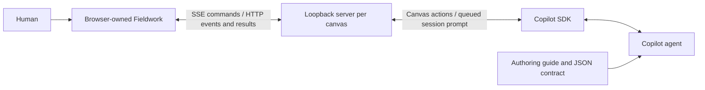

# Fieldwork × Copilot Canvas — disposable experiment

This directory implements an experimental integration without modifying the canonical Fieldwork HTML, fixtures, docs or architecture. The installer copies them into an isolated extension; the server adds a bridge only to the served experimental HTML. Delete this directory and the installed extension to remove the experiment. No root auto-discovery extension is installed by cloning the repository.

## Architecture



The server listens only on an ephemeral localhost port; a random path capability, exact Host/Origin checks and a bounded body reduce unintended access. It stores only a pending request map and a bounded event log; authoritative state stays in the browser. This is a local prototype, not a production security boundary. No secrets or sensitive data should be used; do not share the local URL. Do not enable public hosting of the experimental bridge.

## First test: ordinary browser (no SDK)

Use Node.js 22+ from this directory:

```sh
node prepare.mjs
node --test test.mjs
node demo.mjs
```

Open the printed loopback URL. Confirm existing Fieldwork appears, click an object and then Ask Copilot about selection: the deterministic provider adds a card. After connecting, a timer sends an independent update. Pan or zoom, and confirm the original runtime remains responsive. Stop with Ctrl+C. The test harness checks broker, localhost transport, and a simulated browser acknowledgement; it does not replace a real browser or Copilot test.

## Install into Copilot (opt-in user scope)

```sh
node prepare.mjs --install
```

This copies the experiment and source assets into the local Copilot home extensions/fieldwork-experiment folder, refusing to overwrite an existing installation. It intentionally does not modify .github/extensions. The SDK is expected to be supplied by the installed Copilot host; do not install an arbitrary SDK version. In a local Copilot app session, consult the installed extension guide and canvas SDK types (extensions_manage guide), reload extensions, inspect fieldwork-experiment, then ask the agent to open canvas ID fieldwork-experiment with instance ID fieldwork-demo. Extension loading, SDK import and the host's iframe policies must be tested locally; the interface is experimental. If the installed host uses another extension layout or API, adapt only extension.mjs and prepare.mjs. No Copilot configuration is changed automatically.

## Validation matrix

| Milestone | Implementation | Local acceptance |
|---|---|---|
| Render in Copilot | SDK open handler serves isolated runtime | Open panel; check map, zoom, narrow layout and no script errors |
| Agent → UI | inspect_workspace, apply_commands, load_scene | Ask agent to add card, update risk metric and focus it |
| UI → agent | Explicit Ask Copilot button; session.send enqueue; event log | Verify a queued turn appears in same session and modifies the panel; repeat while agent is busy |
| Proactive | SSE transport + actions callable without browser event; deterministic timed demo | Agent adds card during manual pan; confirm camera stays under human control |
| Composition | authoring_guide returns original contract, style guide and example | Ask agent to compose a synthetic workspace; review coherence and schema |
| Feedback | Request correlation, revision/epoch check, acknowledgement, veto event collection | Reject invalid/stale commands; inspect after disconnect or timeout |
| Zoom-triggered reasoning | Optional manual-zoom heuristic, off by default; camera telemetry | Enable checkbox, manually cross a declared threshold, verify one queued turn; test agent motion does not prompt |

The host-dependent paths, including session.send mode enqueue and whether the host permits SSE, same-origin POSTs and browser crypto inside its iframe, are not verified in this environment. If crypto.randomUUID is unavailable, use a browser-supported random identifier. The runtime revision resets on scene replacement; bridgeEpoch combines a random renderer identity and a counter that changes on scene replacement and disconnect. Always inspect a newly opened panel. Acknowledgement timeout means outcome unknown. No durable synchronization or automatic replay is implemented. The existing runtime supports camera flights, not generalized multi-step choreography. Production authentication, stronger session fencing, rate limits, full schemas and provider autonomy are outside this proof of concept.

## References
- https://docs.github.com/en/copilot/how-tos/github-copilot-app/working-with-canvas-extensions
- https://github.com/microsoft/copilot-sdk/blob/main/nodejs/src/canvas.ts
- https://github.com/github/copilot-sdk/blob/main/nodejs/docs/agent-author.md
- https://github.com/microsoft/copilot-sdk/blob/main/docs/features/steering-and-queueing.md
